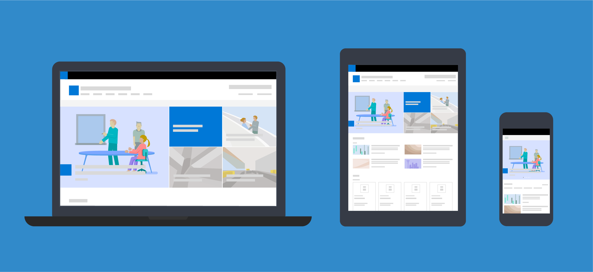

# Designing great SharePoint experiences

Use this guidance to design accessible SharePoint sites, pages, and custom components. Choose guidance for the actual host: a SharePoint page layout isn't the layout contract for a Copilot conversation or a Viva Connections card.

## Design for the component's host

- **Copilot UX components:** follow [Copilot theme and design guidance](../spfx/copilot/theme-and-design.md), [display modes](../spfx/copilot/displayMode.md), and [visible-context guidance](../spfx/copilot/provide-context-to-copilot.md). The host controls the surrounding conversation; the component owns its iframe UI.
- **SharePoint web parts and extensions:** use the page design principles below and the [SPFx Fluent UI guidance](../spfx/fluent-ui-integration.md). Match the library version to the component/template instead of upgrading every sample to the same Fluent UI version.
- **Viva Connections:** start with the [Adaptive Card Extension guidance](../spfx/viva/overview-viva-connections.md).

Test keyboard access, focus, themes, resizing, and error states in each supported host. A responsive design or a mobile-sized mockup doesn't establish client support; Copilot UX components don't support iOS/Android at GA.

## SharePoint design principles

SharePoint builds on the design principles that shape the Office and Microsoft product families. These principles help the design stay true to our product goals and user needs.

### Optimistic and fast

SharePoint is encouraging, knowing people can achieve whatever they set their minds to when given the platform and the support they need. We're fast and agile, and we adjust our product experience based on feedback and input.

### Dynamic and alive

We thrive on the dynamism in the world and love the way that change can open new possibilities for people. We’re fearless about reinventing ourselves, continually changing for the better to meet the needs of the people and companies changing the world around us.

### Authentic and useful

Our passion is to help people achieve, and it has been for more than 30 years. We care about it in a way that no one else does. We understand the importance of our customers and make sure that SharePoint stays relevant and useful by staying authentic and true.

### Forward-thinking

We search for what’s possible beyond today’s way of getting things done. We’re energized by all that people are capable of achieving and seek to support and amplify it through our platform. We care about the needs of people not only today but tomorrow—anticipating what and how they’ll want to achieve. So we build our technology around who they can be and what they can become.

### Accessible and optimized

Accessibility is developing an equal experience for all users that enables individuals to adjust their user experience to meet their unique visual, hearing, dexterity, cognitive, and speech needs. SharePoint believes strongly in providing accessible experiences for everyone, everywhere, and in optimizing our experiences to reflect the needs of all of our customers.

<!-- These seem like fairly high-level principles; it would be good to think about how to convey how these principles manifest in the design. Can you add a design example to each section that illustrate the principle? -->

## SharePoint Web UI Kit in Figma

The SharePoint Web UI Kit empowers you to design communication and team sites for desktop, tablet and mobile in Figma. ​This kit delivers a set of web parts, style options, templates, and detailed guidance so you can quickly design engaging sites and pages in Figma. Figma is a subscription-based application that is the industry standard tool for web design, and provides an alternative to designing sites and pages outside of SharePoint. 

[Access the kit in Figma Community](https://aka.ms/SPWebUIkit)

[Watch a live demo on YouTube with the product team](https://youtu.be/2UPchEYhuxI?si=x8ZWEBe3YZQL3Dkp)

### Design without organizational limitations 

This UI kit provides SharePoint users with another tool in their toolbox. While building a page in SharePoint is easy, we wanted to provide the ability to mockup sites and pages. It allows you to explore different design options for your site without the limitation of admin privileges and tenant restrictions, and doesn’t expose organization data.  

Figma mockups provide a quick snapshot of SharePoint updates which business stakeholders can use to plan and make decisions. They can provide appropriate requirements and use this UI kit in collaboration with their design team to iterate in the life cycle of your organization's intranet. 

### Share designs with ease 

This UI kit provides you with page layouts and a selection of web parts to allow you to mockup and share new ideas across organizations and companies. Figma gives you the flexibility of reviewing and sharing your designs without having to spend time and resources creating it in SharePoint. Figma also allows you to download your designs into easy-to-use formats that can be used in documentation and presentations. Learn more at https://www.figma.com/  

Note that Figma does not build the pages in SharePoint, so once you finalize a design in Figma, you will need to build it in SharePoint. You should evaluate if Figma is the right solution for mocking up sites and pages for SharePoint.  

### Community feedback 

Please tell us what’s missing, what doesn’t work for you, and where your biggest challenges are by leaving a comment on the [Figma SharePoint Web UI kit page](https://aka.ms/SPWebUIkit).  

### Past Tech Community blog posts for each SharePoint Web UI Kit release

v3.0: [Figma Variables and new components available (v3.0.0) in the SharePoint Web UI Kit](https://techcommunity.microsoft.com/t5/microsoft-sharepoint-blog/figma-variables-and-new-components-available-v3-0-0-in-the/ba-p/4180339)

v2.2: [SharePoint Web UI Kit - New Figma web part components available (v2.2) and feedback requested](https://techcommunity.microsoft.com/t5/microsoft-sharepoint-blog/sharepoint-web-ui-kit-new-figma-web-part-components-available-v2/ba-p/4031084)

v2.1: [New web parts available in the SharePoint Web UI kit!](https://techcommunity.microsoft.com/t5/microsoft-sharepoint-blog/new-web-parts-available-in-the-sharepoint-web-ui-kit/ba-p/3956251)

v2.0: [Updated content for the SharePoint Web UI kit!](https://techcommunity.microsoft.com/t5/microsoft-sharepoint-blog/updated-content-for-the-sharepoint-web-ui-kit/ba-p/3905250)

v1.0: [Introducing a new SharePoint Web UI kit!](https://techcommunity.microsoft.com/t5/microsoft-sharepoint-blog/introducing-a-new-sharepoint-web-ui-kit/ba-p/3870293)

## See also

- [Overview of SharePoint Framework](../spfx/sharepoint-framework-overview.md)
