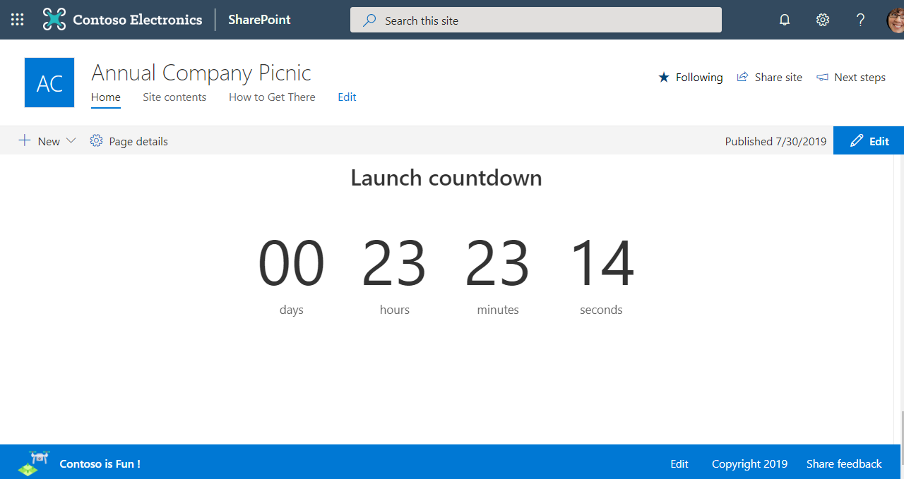
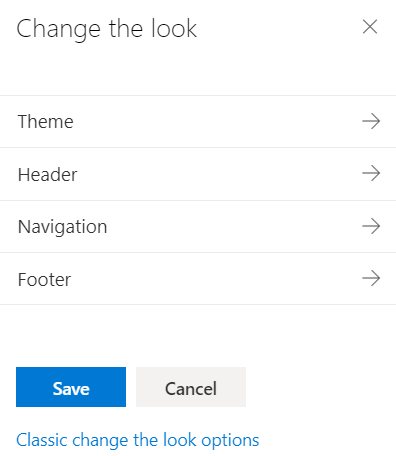
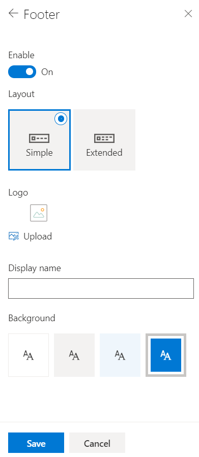

# SharePoint Site Footer

Footers are a common branding / navigation control in websites and portals. SharePoint Communication sites will have an out-of-the box footer control, which can be controlled either using UI elements or by using APIs. This control supports following elements

- 8 links or labels
- Footer logo
- Footer name

> [!IMPORTANT]
> Footer settings apply to supported communication-site layouts. Check the current [Change the look guidance](https://support.microsoft.com/office/06bbadc3-6b04-4a60-9d14-894f6a170818) for available layouts and options rather than treating the original rollout announcement or screenshots as current defaults.
>
> Footers don't appear in sites on mobile devices or apps.

## Sample footer

Following picture demonstrates a footer with a logo, footer name and labels and links.



## Controlling footer rendering using code or PowerShell

> [!IMPORTANT]
> The script below is a historical example, not the current authentication baseline. Follow the [PnP PowerShell authentication guidance](https://pnp.github.io/powershell/articles/authentication.html), use your own Microsoft Entra application, and validate the current cmdlets. Don't disable multifactor authentication or rely on a password-only connection to reproduce the example.

You can control the footer existence with a `FooterEnabled` property in the `Web` object. Following PowerShell scripts shows how this can be done using [PnP PowerShell cmdlets](/powershell/sharepoint/sharepoint-pnp/sharepoint-pnp-cmdlets):

```powershell
Connect-PnPOnline -Url "<SiteURL>" –Credentials (Get-Credential)
Set-PnPFooter -Enabled:$false # for disabling the footer
Set-PnPFooter -Enabled:$true # for enabling the footer
```

> [!NOTE]
> Use a PnP PowerShell version and authentication method supported for your environment. Follow its current installation and app-registration prerequisites; the historical connection command above hasn't been validated as a current setup procedure.

[!INCLUDE [pnp-powershell](../../includes/snippets/open-source/pnp-powershell.md)]

## Controlling footer using the user interface

Site owner can control the footer visibility using the **Change the look** functionality of the site, which exposes the different user interface configuration options.

> [!NOTE]
> Screenshots show an earlier interface. Use the current site settings and supported site layout when configuring the footer.



Footer configuration has multiple different options, which can be configured based on the site objectives.



## See also

- [Change the look of your SharePoint site](https://support.office.com/article/change-the-look-of-your-sharepoint-site-06bbadc3-6b04-4a60-9d14-894f6a170818)
