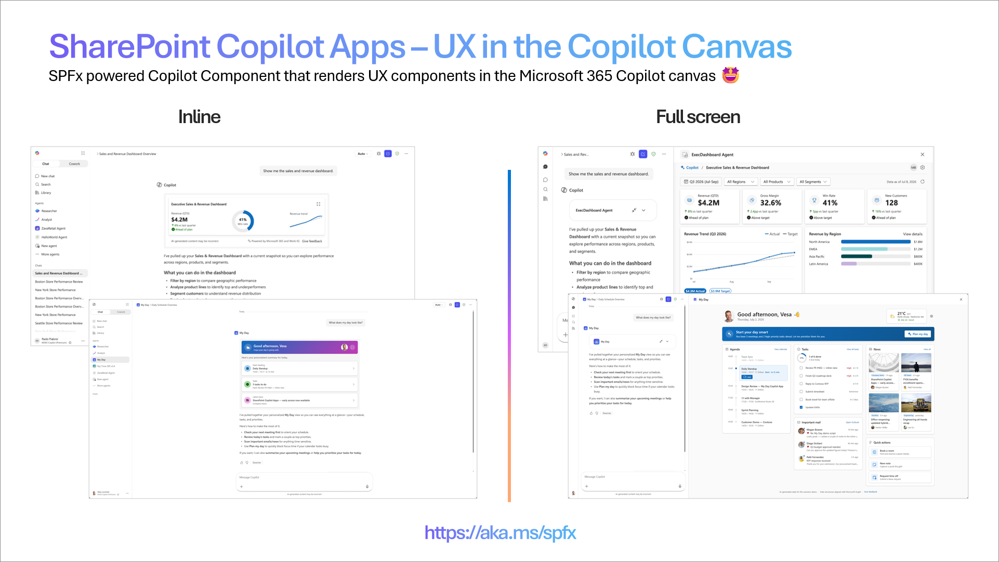
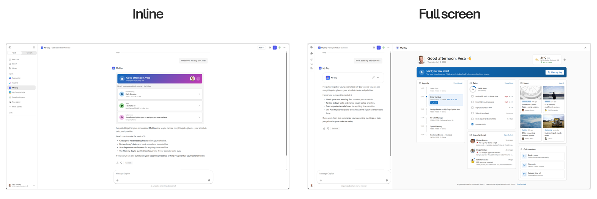
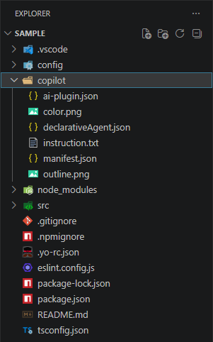
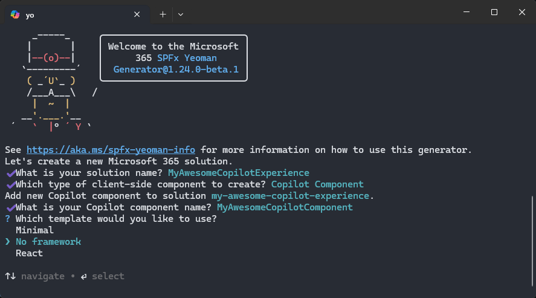
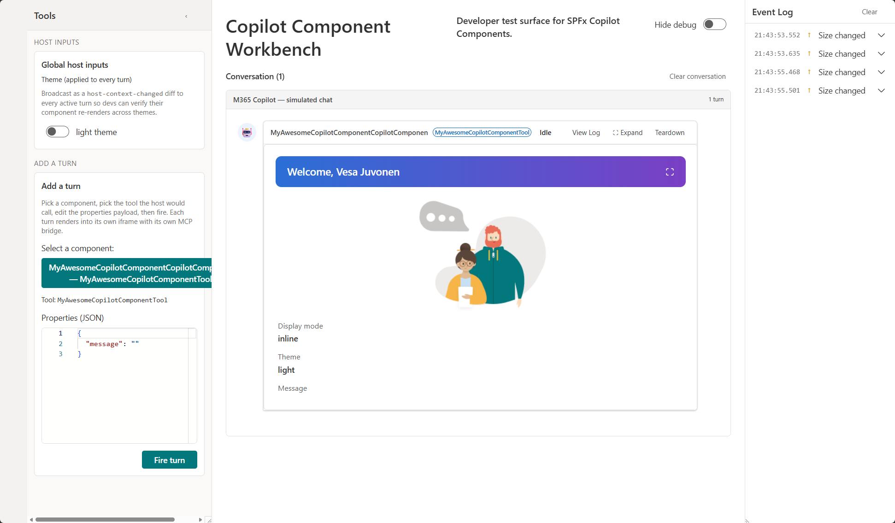

# Overview of Copilot UX components

Copilot UX components are generally available with **SharePoint Framework 1.24**, released on **October 28, 2026**. For licensing, supported clients, and distribution, see [Availability](#availability). Review the [GA limitations](#ga-limitations) before deployment.

You can use **Copilot UX components** to extend Microsoft 365 Copilot with custom, interactive experiences that you build using the familiar SharePoint Framework (SPFx) tools, libraries, and client-side development model. A solution can package one or more Copilot UX components - client-side UI components that render inside Microsoft 365 Copilot - together with a **declarative agent** definition that makes them discoverable and callable from within a Copilot conversation.



Where SPFx web parts and extensions extend the *SharePoint* user experience, Copilot UX components extend the *Microsoft 365 Copilot* experience. You author them with the same toolchain (`heft`, TypeScript, SCSS, the `@microsoft/sp-*` libraries), package them in a SharePoint solution package (`.sppkg`), and deploy them through the SharePoint App Catalog you already use.

Copilot UX components enable you to:

- **Render rich, interactive UI inside Copilot** - Surface custom, branded experiences directly in a Copilot conversation instead of returning plain text.
- **Ship agent logic and UI together** - A single package contains both the declarative agent definition and the Copilot UX components it renders.
- **Reuse your SharePoint Framework skills** - Use the same project structure, build tooling, and deployment pipeline as your existing SPFx solutions.
- **Move solutions across tenants easily** - Because Copilot UX components are built with SPFx and packaged in a standard `.sppkg`, you can move them between tenants simply by deploying the same package to another tenant's SharePoint App Catalog.
- **Share the same UX across surfaces** - Build a UX component once and reuse it across Microsoft 365 - in Microsoft 365 Copilot, in SharePoint, and in Microsoft Teams - for a consistent end-user experience wherever people work.

## Build once, reach every surface

A key benefit of the SharePoint Framework model is that your UX components aren't tied to a single surface. The same interactive UI you render inside Microsoft 365 Copilot can also power an SPFx web part in SharePoint or a tab in Microsoft Teams, so users get the same experience regardless of which application they start from.

This works because SPFx separates the *hosting* concern from the *UI* concern. A Copilot UX component and a web part derive from different base classes: a Copilot UX component extends `BaseCopilotComponent`, while a web part extends `BaseClientSideWebPart`. Each base class adapts the component to its host (the Copilot canvas versus a SharePoint page), but what each one hosts can be the same underlying UX component. You factor your interface, business logic, and styling into shared, framework-agnostic components (for example, React, Angular, Vue, or Svelte), and each surface-specific base class renders them.

A single SPFx solution package (`.sppkg`) can contain a mix of different component types, such as Copilot UX components, web parts, and extensions, side by side. This lets you ship one solution that surfaces the same shared UX across Copilot, SharePoint, and Teams, while packaging, deploying, and versioning everything as a single unit.

The result is a single investment in your UX that delivers a consistent, branded experience across Copilot, SharePoint, and Teams, without rebuilding the core interaction pattern for every surface.

> [!IMPORTANT]
> Reusing UI across hosts doesn't make a Copilot UX component directly runnable as a web part or Teams tab. Use the appropriate host-specific base class. At GA, a solution combining Copilot UX components and SPFx Teams functionality requires a manually created Teams package because automatic **Sync to Teams** has a mismatch for this combination. See [GA limitations](#ga-limitations).

## Key concepts

The following sections describe the concepts that are important to understand when you build Copilot UX components.

### Two display modes

A Copilot UX component declares the display modes it supports in its component manifest through the `availableDisplayModes` capability. Microsoft 365 Copilot renders the component in one of two layouts:

- **`inline`** - The component renders inline within the Copilot conversation, alongside the chat flow. This is the fallback, compact presentation when no supported fullscreen startup preference is granted.
- **`fullscreen`** - The component expands to occupy the full Copilot surface, giving it maximum space for richer interactions.

The host owns the layout. Your component reads the current mode from `this.hostContext.displayMode` and can *request* expansion to fullscreen by calling `this.requestDisplayModeAsync('fullscreen')`. Collapsing back to inline is always host-initiated - the user clicks the host's collapse affordance, and your component is notified through `onHostContextChanged`.

Set `capabilities.defaultDisplayMode` to choose a startup preference from the declared available modes. The host can decline a fullscreen preference, and its later mode updates remain authoritative. See [Display modes](displayMode.md) for close/reopen behavior.

```json
// HelloCopilotCopilotComponent.manifest.json (excerpt)
"capabilities": {
  "availableDisplayModes": ["inline", "fullscreen"]
}
```

The following example shows the My Day scenario in both display modes.

> [!div class="mx-imgBorder"]
> 

### Multiple tools in one package

A single solution package can expose multiple tools. Each Copilot UX component declares one or more tools in its manifest, and each tool becomes an action the declarative agent can invoke. This lets you group related capabilities, for example a "status" tool and a "reporting" tool, into one deployable unit that shares build output, hosting, and lifecycle.

```json
// HelloCopilotCopilotComponent.manifest.json (excerpt)
"tools": [
  {
    "name": "HelloCopilotTool",
    "description": { "default": "helloCopilot description" },
    "propertiesSchema": {
      "id": "$../../../lib/copilotComponents/helloCopilot/HelloCopilotCopilotComponentProperties.js:default;"
    }
  }
]
```

### Parameterized initial rendering

Each tool can define a properties schema that describes the parameters it accepts. When the declarative agent invokes a tool, Microsoft 365 Copilot passes these properties into the component, which uses them to control its initial rendering. This means the same component can present different content depending on the parameters supplied for a given invocation.

Your component reads these values from `this.properties` at render time:

```ts
// HelloCopilotCopilotComponent.ts (excerpt)
protected render(): void {
  const message: string = this.properties.message;
  // ...use message and other properties to drive the initial render
}
```

Because parameters shape the first render, a single tool can serve many scenarios without you shipping a separate component for each one.

### Automatic hosting from the SharePoint App Catalog

Copilot UX components use the same established SPFx deployment and hosting model as solutions built for SharePoint and Microsoft Teams. You deploy the `.sppkg` file to the tenant's SharePoint App Catalog. When `includeClientSideAssets` is set to `true` in **package-solution.json**, the component's JavaScript and other static assets are bundled into the package and deployed to the **ClientSideAssets** folder in the App Catalog site collection. SharePoint hosts these assets automatically and, depending on the tenant configuration, can serve them through the Microsoft 365 CDN.

Microsoft 365 Copilot loads the hosted client-side assets when it renders the component in the Copilot user experience. You don't deploy the UI code to a separate Copilot host or provision an external content delivery network, Azure Storage account, or other hosting infrastructure. Copilot is another host for SPFx solutions, alongside the SharePoint and Teams experiences that use this pattern today.

```json
// package-solution.json (excerpt)
"solution": {
  "includeClientSideAssets": true
}
```

### Declarative agents synced to the tenant agent catalog

A solution with Copilot UX components defines a declarative agent, a Microsoft 365 Copilot agent described by a manifest, an agent definition, instructions, and one or more actions that map to the components' tools.

After you deploy the app package to the **SharePoint App Catalog**, synchronize the baseline declarative agent to the tenant's agent catalog from the App Catalog. Subsequent component/tool changes are discovered at runtime; changes to the baseline agent configuration require another sync. See [Update components and the baseline agent](#update-components-and-the-baseline-agent).

> [!NOTE]
> An administrator uploads and enables the `.sppkg` file in the SharePoint App Catalog, and then selects **Add to Teams** for the app. This action deploys the declarative agent to the tenant's agent catalog. The label of this button will be updated in a future release to better reflect that it also publishes the agent.

```json
// declarativeAgent.json (excerpt)
{
  "version": "v1.8",
  "name": "helloCopilot Agent",
  "instructions": "$[file('instruction.txt')]",
  "conversation_starters": [
    { "title": "Get started", "text": "What can you do?" }
  ],
  "actions": [
    { "id": "helloCopilotAction", "file": "ai-plugin.json" }
  ]
}
```

## Anatomy of a Copilot UX component solution

The declarative agent definition lives in a dedicated `copilot` folder in your project, alongside the Copilot UX component source under `src/copilotComponents`. The `copilot` folder contains the agent manifest and the files it references.

> [!div class="mx-imgBorder"]
> 

| File | Purpose |
| ---- | ------- |
| `manifest.json` | The Teams/Microsoft 365 app manifest that registers the declarative agent. The developer owns and updates this file - for example, the app name, description, icons, and identifiers. |
| `declarativeAgent.json` | The declarative agent definition: name, description, instructions, conversation starters, and actions. The developer fully controls this file and can use the **full set of declarative agent options** - not only the options required by SPFx-powered Copilot UX components. |
| `ai-plugin.json` | The plugin definition that describes the agent's actions to the model. |
| `instruction.txt` | The natural-language instructions that shape the agent's behavior. |

> [!NOTE]
> Because you author `manifest.json` and `declarativeAgent.json` directly, a solution with Copilot UX components includes a full declarative agent. You can add capabilities such as additional instructions, conversation starters, knowledge sources, and other actions supported by the declarative agent schema - the SPFx Copilot UX components are one part of a broader agent you control.

The Copilot UX component itself is a client-side component that derives from `BaseCopilotComponent`, declares its display modes and tools in a component manifest, and is grouped into an agent through **copilot-agent.json**.

### How the copilot folder is packaged and deployed

You author the source files in the `copilot` folder - most importantly `manifest.json` and `declarativeAgent.json` - and the build combines them with your components. When the solution is built, the toolchain **merges your declarative agent definition** with the details of the Copilot UX components declared in **copilot-agent.json** - the components they reference and each component's tools and properties - and bundles the result into the solution package (`.sppkg`) alongside the component assets. You can see the packaged output under the project's `temp/copilot` folder during a build.

When you upload and enable that package in the **SharePoint App Catalog**, SharePoint hosts the packaged component assets in the App Catalog site collection. When you then select **Add to Teams** for the app, the baseline declarative agent is deployed to the **tenant agent catalog**. Together, these steps make the experience available to licensed users through the supported Microsoft 365 Copilot clients, without requiring you to provision a separate host. Later updates follow the [component and baseline-agent update model](#update-components-and-the-baseline-agent).

## Choose a starter template

When you scaffold a new Copilot UX component, the SharePoint Framework generator offers **three starter templates** - just like the framework choices you already know from web parts. Each template gives you a working Copilot UX component that you can run in the Copilot Workbench right away, so you can pick the starting point that best matches your team's skills and the experience you want to build.

- **Minimal** - The leanest possible starting point, with only the code needed to render a Copilot UX component. Ideal for learning the model or building up an experience from scratch.
- **No framework** - Plain TypeScript with no UI framework, for full control over the rendering without additional dependencies.
- **React** - A React-based starting point for teams already building with React.

> [!div class="mx-imgBorder"]
> 

## Test with the Copilot Workbench

The **Copilot Workbench** is fully supported and remains the local development and testing model for Copilot UX components. It lets you test components hosted on your development machine before you package and deploy them to the SharePoint App Catalog and sync the baseline agent to Microsoft 365 Copilot. Run your component from `localhost`, load it in the Workbench, and iterate on rendering, display modes, and tool parameters without a full deployment cycle. Workbench testing doesn't validate agent discovery or intent matching; test those in a deployed agent.

Development and testing in Copilot Workbench require the same Microsoft 365 Copilot add-on license as production use. See [Licensing and costs](#licensing-and-costs).

The Copilot Workbench is always available at the `/_layouts/15/copilotworkbench.aspx` path of any SharePoint site in your tenant - for example, `https://yourtenantname.sharepoint.com/_layouts/15/copilotworkbench.aspx`. Once your local dev server is running and serving the component from `localhost` - by running `heft start --nobrowser` - browse to that URL and the debug version of your component is loaded in the Workbench, ready for testing and development.

Once you are satisfied with the experience in the Workbench, you build the solution package, deploy it to the SharePoint App Catalog, and select **Add to Teams** to sync the declarative agent to the tenant agent catalog.

> [!div class="mx-imgBorder"]
> 

## Developer guidance and considerations

Keep the following in mind as you build and maintain Copilot UX components.

### Provide context about the visible UX

Use `createCopilotTextContent` to describe the current view, values, filters, and selection. Rendering the component doesn't automatically tell Copilot what the user sees. Model-context updates provide information for subsequent conversation turns; a user-triggered follow-up can ask Copilot to explain the selected data.

The GA limit for text context supplied using `createCopilotTextContent` is **10 KB**. Text context larger than this limit blocks sending the message rather than being silently truncated. See [Provide Copilot with context from your component](provide-context-to-copilot.md) for the bridge operations, error handling, and deliberate reduction/retry workflow.

### Update components and the baseline agent

The initial **Sync to Teams** operation, labeled **Add to Teams** in the SharePoint App Catalog, deploys the baseline agent definition. After that, [dynamic tool discovery](/microsoft-365/copilot/extensibility/plugin-dynamic-tool-discovery) detects changes to tool parameters and additions or removals of components/functions at runtime.

Rebuild, package, and redeploy the solution when component code or tool definitions change. You don't need to sync again if the baseline agent configuration hasn't changed. Changes to that baseline, such as its image, title, instructions, or starter prompts, require another sync.

The numeric app `version` in `copilot/manifest.json` is separate from the declarative-agent schema version, such as `v1.8` in `declarativeAgent.json`. Don't increment the schema version as a deployment counter.

> [!NOTE]
> Dynamic tool discovery caches tool definitions for a few minutes, so new functions or updated definitions can take a few minutes to become available after you deploy an updated `.sppkg`. UX changes are available immediately after deployment because the component code is served directly from the SharePoint App Catalog site collection. Allow for the discovery cache to refresh, then test updated tools in a new conversation.

For the complete update decision table, versioning, cross-tenant deployment, and retirement considerations, see [Develop and deploy Copilot UX components](development-and-deployment.md). See [Configure Copilot UX components and agents](component-and-agent-configuration.md) for component manifests and grouping.

### Reuse UI without sharing tenant assumptions

Share UI and business logic, but keep host adapters and tenant configuration separate. Use `BaseCopilotComponent` for Copilot and `BaseClientSideWebPart` for web parts. Follow [Teams integration](../integrate-with-teams-introduction.md) and [Outlook/Office hosting guidance](../office/overview.md) for those hosts; a Copilot component manifest doesn't run unchanged in every application.

Deploying the same `.sppkg` to another tenant doesn't grant access to data, provision a backend, or copy consent and agent policies. Configure and test each tenant independently. The combined Copilot/Teams automatic-sync limitation still applies when packaging shared UI in one solution.

## Availability

Copilot UX components are generally available starting with SPFx 1.24 on **October 28, 2026**.

### Licensing and costs

Copilot UX components require a **USL (user-specific license)**: the **Microsoft 365 Copilot add-on license** on top of the user's normal **E3, E5, or E7** license. A base license alone isn't sufficient. The same requirement applies to development and testing, including Copilot Workbench. Users without the required add-on can't use the component experience.

Copilot UX components **don't fall under a consumption-based plan and have no consumption-based charges**. APIs or services called inside a component's implementation can have their own charges. Those charges are separate from the component capability; consumption billing isn't an alternative to the required user license.

Use an account with the required Copilot add-on license when validating the component in Copilot.

### Supported clients

Copilot UX components are supported in:

- Microsoft 365 Copilot in browser and desktop clients.
- Copilot in Microsoft Teams in browser and desktop clients.

iOS and Android clients, including Teams mobile, aren't supported at GA. See [GA limitations](#ga-limitations).

### SharePoint Store distribution

Solutions containing Copilot UX components are supported in the **SharePoint Store starting with SPFx 1.24 GA**. This includes Store solutions that add Copilot UX components. See [Publish SharePoint Framework solutions to the SharePoint Store](../publish-to-marketplace-overview.md) for the submission process. SharePoint Store support doesn't imply support for independent distribution through the Teams Store.

You can also deploy solutions privately through your tenant's SharePoint App Catalog. In either case, deploy the solution and sync the baseline agent before users access it.

## GA limitations

- **Combined Copilot/Teams solutions:** Combining Copilot UX components and SPFx Teams functionality in the same solution causes a mismatch in automatic **Sync to Teams** at GA. Manually creating the Teams package for the solution works as a workaround. See [Deploy SPFx solutions to Microsoft Teams](../deployment-spfx-teams-solutions.md) for developer-provided package guidance. This is an automatic packaging/sync limitation, not a prohibition on sharing UI code across hosts.
- **Mobile clients:** Copilot UX components aren't supported on iOS or Android, including Teams mobile, at GA. Responsive UI and mobile-related SDK types don't establish mobile support.
- **Additional Copilot surfaces:** Standard-chat Copilot plug-in packaging, Cowork, and other additional surfaces aren't GA capabilities of this release.

A fix for combined-solution automatic sync and support for mobile clients are planned as fast follows after GA. No delivery dates are committed.

## Next steps

> [!div class="nextstepaction"]
> [Build your first Copilot UX component](get-started/build-your-first-copilot-app.md)

- Learn how the [`displayMode`](displayMode.md) host context works and how to add an expand-to-fullscreen control.
- Review available samples in the [Copilot UX component sample gallery](https://aka.ms/spfx/copilot/samples).
- [Develop and deploy Copilot UX components](development-and-deployment.md).
- [Provide context to Copilot](provide-context-to-copilot.md).

## See also

- [Get started building SharePoint Framework solutions](/sharepoint/dev/spfx/set-up-your-developer-tenant)
- [Declarative agents for Microsoft 365 Copilot](/microsoft-365-copilot/extensibility/overview-declarative-agent)
