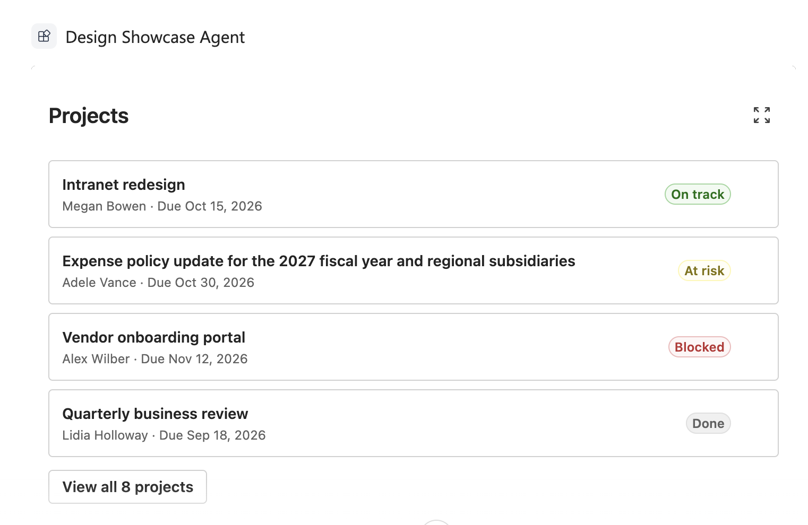

# Theme and design for the Copilot canvas

A Copilot UX component runs in an iframe on the Microsoft 365 Copilot canvas. The host context has fields for the theme, the display mode, the container size, and the platform, but the host supplies no design tokens, so the component brings its own design system. This article uses Fluent UI v9, which the React template includes. The code in this article comes from the [tutorial-theme-and-design sample](https://github.com/pnp/spfx-copilot-components/tree/main/samples/tutorial-theme-and-design).

## What the host tells you

The host sends its state in `this.hostContext`. Every field is optional.

| Field | Type | Use it for |
| --- | --- | --- |
| `theme` | `'light' \| 'dark'` | The Fluent UI theme. |
| `displayMode` | `'inline' \| 'fullscreen'` | The view to render. |
| `availableDisplayModes` | Array of display modes | Whether to show an expand control. |
| `containerDimensions` | `{ width?, height?, maxWidth?, maxHeight? }` | The size of the container, in pixels. |
| `platform` | `'web' \| 'desktop' \| 'mobile'` | The type of device. |
| `deviceCapabilities` | `{ touch?, hover? }` | Whether the device supports touch and hover. |

> [!NOTE]
> Mobile-related host context fields don't establish client support. Copilot UX components aren't supported on iOS or Android at GA, including Teams mobile. See [Availability](overview-copilot-apps.md#availability).

The framework calls `render()` again when a value changes. Read `this.hostContext` on every render, and don't keep a copy:

```typescript
protected render(): void {
  const props: IDesignShowcaseProps = {
    projects: PROJECTS,
    locale: this.context.pageContext.cultureInfo.currentUICultureName,
    // Pass the host context as it is now. Do not keep a copy.
    hostContext: this.hostContext,
    onRequestDisplayMode: async (mode: SPCopilotDisplayMode): Promise<void> => {
      await this.requestDisplayModeAsync(mode);
    },
    // The component runs in an iframe. Styles must go to its document.
    targetDocument: this.context.domElement.ownerDocument,
    strings
  };

  if (!this._root) {
    this._root = createRoot(this.context.domElement);
  }

  this._root.render(React.createElement(DesignShowcase, props));
}
```

The hosts don't populate every field. In the Copilot Workbench, `containerDimensions` and `deviceCapabilities` are empty objects. Microsoft 365 Copilot doesn't send them. The Workbench reports `platform` as `web`, but Microsoft 365 Copilot in a desktop browser reports `desktop`. Microsoft 365 Copilot also sends a `hostContainer` value of `web`, which isn't part of the `ICopilotComponentHostContext` type. Give every decision a default for when a field is missing.

## Follow the host theme

Map `hostContext.theme` to the Fluent UI `webLightTheme` and `webDarkTheme`. When the value is undefined, use the light theme. You can test the dark theme in the Copilot Workbench, which has a light and dark theme control; the component switches with no reload.

```typescript
/** The host theme is optional. Use the light theme when it is missing. */
export function resolveFluentTheme(theme: SPCopilotTheme | undefined): Theme {
  return theme === 'dark' ? webDarkTheme : webLightTheme;
}
```

## Render styles into the component's document

The component element belongs to the document of the iframe. Fluent UI and its style engine, Griffel, insert styles into a document, and styles added to the parent document don't reach the component. The `targetDocument` line in the `render()` method shown earlier passes `this.context.domElement.ownerDocument`, the document of the iframe, to the React tree. Then pass the document to the Griffel renderer and to `FluentProvider`:

```typescript
export function ThemeProvider(props: IThemeProviderProps): React.ReactElement {
  const renderer = React.useMemo(
    () => createDOMRenderer(props.targetDocument),
    [props.targetDocument]
  );

  return (
    <IdPrefixProvider value="copilot-component-">
      <RendererProvider renderer={renderer} targetDocument={props.targetDocument}>
        <FluentProvider
          theme={resolveFluentTheme(props.theme)}
          targetDocument={props.targetDocument}
          style={{ minHeight: '100%' }}
        >
          {props.children}
        </FluentProvider>
      </RendererProvider>
    </IdPrefixProvider>
  );
}
```

A `makeStyles` hook called outside the provider uses the default renderer, so call `makeStyles` hooks only in components rendered inside the provider. The root component of the sample renders the provider and nothing else:

```typescript
export default function DesignShowcase(props: IDesignShowcaseProps): React.ReactElement {
  return (
    <ThemeProvider theme={props.hostContext.theme} targetDocument={props.targetDocument}>
      <ShowcaseBody {...props} />
    </ThemeProvider>
  );
}
```

With this setup, the Fluent UI styles apply in the Copilot Workbench and in Microsoft 365 Copilot, in the light and the dark theme, in both display modes.

## Use tokens, not colors

Style the component with `makeStyles` and Fluent UI tokens. A token resolves to a different value in each theme, so one style works in both themes with no per-theme code. Don't use hex or rgb values. The project card uses tokens for its spacing, border, background, and text:

```typescript
const useStyles = makeStyles({
  root: {
    // ...
    paddingTop: tokens.spacingVerticalM,
    // ...
    ...shorthands.border(tokens.strokeWidthThin, 'solid', tokens.colorNeutralStroke1),
    borderRadius: tokens.borderRadiusMedium,
    backgroundColor: tokens.colorNeutralBackground1,
    color: tokens.colorNeutralForeground1,
    // ...
    ...createFocusOutlineStyle()
  },
  selected: {
    backgroundColor: tokens.colorNeutralBackground1Selected,
    ...shorthands.borderColor(tokens.colorBrandStroke1)
  },
  // ...
});
```

Show a status in words as well as in color. The status badge always shows its label:

```typescript
export function StatusBadge(props: IStatusBadgeProps): React.ReactElement {
  return (
    <Badge appearance="tint" color={STATUS_COLOR[props.status]}>
      {props.label}
    </Badge>
  );
}
```

## Design the inline view

The inline view sits in the conversation. Give it a fluid width with no fixed pixel width, so that it works down to approximately 320 pixels. In Microsoft 365 Copilot on the web, the inline view was 415 to 720 pixels wide as the browser window changed.

```typescript
const useStyles = makeStyles({
  // Fluid width. No fixed pixel width, so the view works down to
  // about 320 pixels.
  root: {
    display: 'flex',
    flexDirection: 'column',
    rowGap: tokens.spacingVerticalM,
    boxSizing: 'border-box',
    width: '100%',
    minWidth: 0,
    padding: tokens.spacingHorizontalL
  },
  // ...
});
```

Give the inline view one focused job. The sample shows the first four projects and a button that opens the full list. The [display mode article](displayMode.md) states that the host supplies no expand control, so the component supplies it. Show the control only when `availableDisplayModes` includes `fullscreen`:

```typescript
<div className={styles.header}>
  <Subtitle1 as="h2">{strings.Title}</Subtitle1>
  {/* The host does not supply an expand control. The component does. */}
  {layout.canExpand && (
    <Button
      appearance="subtle"
      icon={<ArrowExpand24Regular />}
      aria-label={strings.ExpandButtonLabel}
      title={strings.ExpandButtonLabel}
      onClick={props.onExpand}
    />
  )}
</div>
```

```typescript
const canExpand: boolean =
  !isFullscreen && (hostContext.availableDisplayModes ?? []).indexOf('fullscreen') !== -1;
```

The expand button calls `requestDisplayModeAsync('fullscreen')`. For more information, see [Display modes in Copilot UX components](displayMode.md).

> [!div class="mx-imgBorder"]
> 

## Design the fullscreen view

Use the extra space for more columns and a second region. Don't stretch the inline layout. The sample places a card grid and a details pane side by side, and stacks them when the container is narrow:

```typescript
body: {
  display: 'grid',
  alignItems: 'start',
  gap: tokens.spacingHorizontalL
},
// The extra space holds a second region. The inline layout is not
// stretched.
wide: {
  gridTemplateColumns: 'minmax(0, 1fr) 320px'
},
stacked: {
  gridTemplateColumns: 'minmax(0, 1fr)'
},
// The number of columns follows the width. No breakpoint code.
grid: {
  display: 'grid',
  gridTemplateColumns: 'repeat(auto-fill, minmax(220px, 1fr))',
  gap: tokens.spacingHorizontalM,
  // ...
},
```

Keep state above both views, so that it stays when the display mode changes:

```typescript
// The selection lives above both views, so it stays when the host
// changes the display mode.
const [selectedId, setSelectedId] = React.useState<string | undefined>(undefined);
// ...
{layout.isFullscreen ? (
  <FullscreenView {...viewProps} />
) : (
  <InlineView {...viewProps} onExpand={handleExpand} />
)}
```

In the Copilot Workbench, the selected card stays selected in fullscreen, with its details shown, and stays selected after the return to inline. In Microsoft 365 Copilot, the selected card stays selected in fullscreen, with its details shown.

In Microsoft 365 Copilot, the fullscreen view opens as a panel next to the chat. The host owns the way out of fullscreen, so the fullscreen view shows no collapse control. Use `requestDisplayModeAsync('fullscreen')` to request expansion, and leave the return to inline to the host. Don't rely on undocumented behavior to collapse the component.

> [!div class="mx-imgBorder"]
> 

> [!NOTE]
> In Microsoft 365 Copilot, the fullscreen panel is taller than the sample's content, and the sample's background covers only the content. In the dark theme, that background is a lighter gray than the panel, and an edge shows below the cards. In the light theme, a black strip shows below the component.

## Adapt to size and device

Let CSS handle what it can. The card grid uses `auto-fill`, so the number of columns follows the width with no code. Use the width for the decisions that CSS can't make, such as where to put the details pane, and use `platform` for the device. Because the hosts don't send usable `containerDimensions`, the sample measures its own width with a `ResizeObserver` and uses `containerDimensions` only before the first measure:

```typescript
export function resolveHostLayout(
  hostContext: ICopilotComponentHostContext,
  measuredWidth: number | undefined
): IHostLayout {
  // ...
  // The measured width is the real width of the component. The width
  // the host reports is used for the first render, before a measure.
  const width: number | undefined = measuredWidth ?? hostContext.containerDimensions?.width;

  const isMobile: boolean = hostContext.platform === 'mobile';
  const isNarrow: boolean = isMobile || (width !== undefined && width < NARROW_WIDTH);
  const canHover: boolean = !isMobile && hostContext.deviceCapabilities?.hover !== false;

  return { isFullscreen, canExpand, width, isNarrow, canHover };
}
```

Don't depend on hover when `deviceCapabilities.hover` is `false`. The card hides its chevron until hover only when the device can hover. Otherwise, the chevron is always visible:

```typescript
// Hover styles apply only when the device can hover. On a touch
// device the icon is always visible.
hover: {
  ':hover': {
    backgroundColor: tokens.colorNeutralBackground1Hover
  },
  '& .designShowcase-affordance': {
    opacity: 0
  },
  '&:hover .designShowcase-affordance': {
    opacity: 1
  },
  '&:focus-visible .designShowcase-affordance': {
    opacity: 1
  }
},
```

Neither the Copilot Workbench nor Microsoft 365 Copilot in a desktop browser sends a value for `deviceCapabilities.hover`, so the sample uses hover there. Don't treat `platform` as `web` in Microsoft 365 Copilot: in a desktop browser, it's `desktop`.

## Accessibility

- Fluent UI tokens keep the contrast in both themes.
- Every icon-only control has an `aria-label`, and decorative icons have `aria-hidden`.
- Every control is a native element that the keyboard reaches, with a visible focus indicator.
- Color is never the only signal. Every status badge shows its label.

In the Copilot Workbench, the Tab key reaches every card and button in both views, the focus indicator is always visible, and both Enter and Space select a card.

## Test both themes and both modes

1. Start the local development server.

    ```console
    heft start --nobrowser
    ```

1. Go to the Copilot Workbench of a site in your tenant, for example `https://yourtenantname.sharepoint.com/_layouts/15/copilotworkbench.aspx`, and accept the loading of debug manifests.

1. Activate the component, enter `{}` on the **Raw** tab, and select **Fire turn**.

1. Select the expand button to switch to fullscreen, and then switch back to inline in the Workbench.

1. Switch the theme with the Workbench theme control, and repeat the previous step.

Check each item in both display modes:

| Check | Inline | Fullscreen |
| --- | --- | --- |
| Light theme | Text, borders, and badges are readable. | Text, borders, and badges are readable. |
| Dark theme | No light surfaces or dark text remain. | No light surfaces or dark text remain. |
| 320-pixel width | All text wraps with no clipping and no horizontal scroll bar. | The details pane stacks above the grid. |
| Keyboard only | Tab reaches every card and button, with a visible focus indicator. | Tab reaches every card, with a visible focus indicator. |

## Next steps

- [Display modes in Copilot UX components](displayMode.md)
- [Provide context about the visible UX](provide-context-to-copilot.md)
- [Access data from a Copilot UX component](access-data.md)
- Review the [tutorial-theme-and-design sample](https://github.com/pnp/spfx-copilot-components/tree/main/samples/tutorial-theme-and-design).
