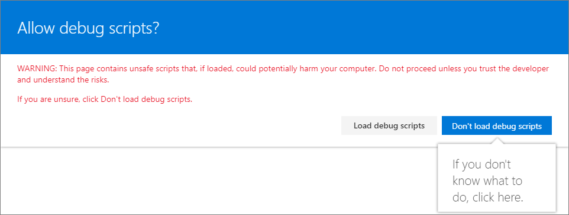
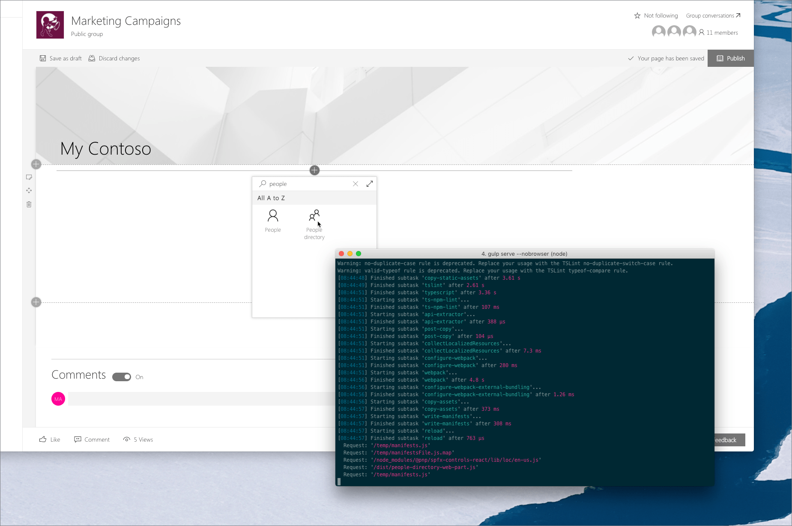

# Debug SharePoint Framework solutions on modern SharePoint pages

Debug SharePoint Framework web parts and extensions on actual modern SharePoint pages using the [SharePoint Framework Debug Toolbar (developer toolbar)](debug-toolbar.md). Choose a page, list, or library that supports your component type. This article uses Heft commands for SPFx 1.22 and later.

[!INCLUDE [spfx-online-workbench-deprecation](../../includes/snippets/spfx-online-workbench-deprecation.md)]

The local workbench was removed in SPFx 1.13. For older gulp-based projects, use `gulp serve` instead of `heft start` and follow the [legacy toolchain guidance](toolchain/sharepoint-framework-toolchain.md).

> [!IMPORTANT]
> While there are no technical restrictions for debugging local SharePoint Framework solutions on modern SharePoint pages, you should be careful when using them in your production tenant. This capability allows you to execute code that hasn't been tested and verified against your organization's policies and could be harmful to your production data.

## Debug SharePoint Framework extensions on modern SharePoint pages

SharePoint Framework extensions require a modern SharePoint page, list, or library that supports the extension type. Use a serve configuration or construct the debug URL manually.

### Debug extensions using serve configuration

When you add a SharePoint Framework extension to your project, the SharePoint Framework Yeoman generator will extend your project's configuration. Using this configuration, you can automatically start a modern SharePoint page in your web browser with all parameters required to debug the extension on that page already present.

#### How it works

When you add a new SharePoint Framework extension to your project, the SharePoint Framework Yeoman generator will add a new entry to the **config/serve.json** file in your project. A sample entry looks as follows:

```json
{
  "$schema": "https://developer.microsoft.com/json-schemas/spfx-build/spfx-serve.schema.json",
  "port": 4321,
  "https": true,
  "serveConfigurations": {
    "default": {
      "pageUrl": "https://contoso.sharepoint.com/sites/mySite/SitePages/myPage.aspx",
      "customActions": {
        "d7678bd7-b58a-44fc-b9fa-a621a89edcad": {
          "location": "ClientSideExtension.ApplicationCustomizer",
          "properties": {
            "testMessage": "Test message"
          }
        }
      }
    },
    "helloWorld": {
      "pageUrl": "https://contoso.sharepoint.com/sites/mySite/SitePages/myPage.aspx",
      "customActions": {
        "d7678bd7-b58a-44fc-b9fa-a621a89edcad": {
          "location": "ClientSideExtension.ApplicationCustomizer",
          "properties": {
            "testMessage": "Test message"
          }
        }
      }
    }
  }
}
```

Next to the default configuration, the SharePoint Framework Yeoman generator will create an entry for each extension that you add to your project. Each entry contains a URL of the modern page that should be used to test the particular extension, the list of extensions that should be loaded, and, for each extension, the list of properties that should be set on them. To use the particular **serve** configuration, execute in the command line:

```console
heft start --serve-config=<name>
```

For example:

```console
heft start --serve-config=helloWorld
```

After running this command, Heft will start your web browser with the modern page specified in your configuration. The page will show a pop-up asking you to confirm that you will now be loading debug scripts.



Once you confirm, the page will load with the extensions you specified in your **serve** configuration.

### Disabling debug scripts

By default, when debug scripts are enabled and allowed once on a page, they'll be allowed throughout the browser session. Select **Stop** on the [Debug Toolbar](debug-toolbar.md) to disable them. You can also include the URL parameter `reset=true` in the request.

### Debug extensions by manually building the debug URL

You can also construct the URL with the required parameters manually. First, start the local web server from your project folder:

```console
heft start --nobrowser
```

Next, in the web browser, navigate to the modern page on which you want to test the extension. After the page loaded, copy its URL. Depending on the type of extension you want to test, there are different parameters that you need to add to the URL.

#### Debug Application Customizer

To debug an Application Customizer, add the following to the URL of your modern page:

> [!CAUTION]
> Line breaks & indentation have been added to the following snippet for readability. The following text should be on a single line with no whitespace.

```json
?loadSPFX=true
&debugManifestsFile=https://localhost:4321/temp/build/manifests.js
&customActions={"<extensionId>":{
    "location":"<extensionType>",
    "properties":<propertiesJSON>
}}
```

For example:

```text
https://contoso.sharepoint.com/sites/team-a/sitepages/news.aspx
    ?loadSPFX=true
    &debugManifestsFile=https://localhost:4321/temp/build/manifests.js&customActions={
        "e5625e23-5c5a-4007-a335-e6c2c3afa485":{
          "location":"ClientSideExtension.ApplicationCustomizer",
          "properties":{
            "testMessage":"Hello as property!"
          }
        }
    }
```

> [!NOTE]
> The development URL was changed in the SPFx v1.21 release from `https://localhost:4321/temp/manifests.js` to `https://localhost:4321/temp/build/manifests.js`.

> [!NOTE]
> Starting with **Chromium 142**, browsers such as **Microsoft Edge** and **Google Chrome** enforce a new security model called **Local Network Access**. Learn more in the Chromium release notes: [Chrome 142 | Release notes: Security - Local network access restrictions](https://developer.chrome.com/release-notes/142#local_network_access_restrictions).
>
> When debugging SPFx solutions, SharePoint Online must load resources from your local development environment (such as `https://localhost:4321`).
>
> When prompted with **“Allow this site to access devices on your local network?”**, you must select **Allow** in Edge or Chrome.
>
> If permission is denied, SPFx debug manifests and bundles cannot load, and the web part will fail during debugging.

The following are the query string parameters that you need to add:

|      Parameter       |                                                                                                                 Description                                                                                                                  |
| -------------------- | ---------------------------------------------------------------------------------------------------------------------------------------------------------------------------------------------------------------------------------------------|
| `loadSPFX=true`      | Ensures that the SharePoint Framework is loaded on the page. For performance reasons, the framework doesn't load unless at least one extension is registered. Because no components are registered, you must explicitly load the framework. |
| `debugManifestsFile` | Specifies that you want to load  components that are locally served. The loader only looks for components in the app catalog (for your deployed solution) and the SharePoint manifest server (for the system libraries).                 |
| `customActions`      | Simulates a custom action. When you deploy and register this component in a site, you'll create this **CustomAction** object and describe all the different properties you can set on it.                                                    |

The `customActions` parameter has the following tokens that should be replaced:

| Token              | Description                                                                                                                                                                             |
|--------------------|-----------------------------------------------------------------------------------------------------------------------------------------------------------------------------------------|
| `<extensionId>`    | Use the GUID of the extension as the key to associate with the custom action. This has to match the ID value of your extension, which is available in the extension **manifest.json** file. |
| `<extensionType>`  | The type of custom action. Use `ClientSideExtension.ApplicationCustomizer` for the Application Customizer extension.                                                                    |
| `<propertiesJSON>` | An optional JSON object that contains properties that are available via the `this.properties` member.                                                                                      |

With the parameters added to the URL, reload the page in the web browser. The page will show a pop-up asking you to confirm that you will now be loading debug scripts.


Once you confirm, the page will load with the extensions you specified in your **serve** configuration.

#### Debug field customizer

To debug a field customizer, add the following to the URL of your modern page:

> [!CAUTION]
> Line breaks & indentation have been added to the following snippet for readability. The following text should be on a single line with no whitespace.

```json
?loadSPFX=true
&debugManifestsFile=https://localhost:4321/temp/build/manifests.js&fieldCustomizers={
    "<fieldName>":{
      "id":"<fieldCustomizerId>",
      "properties":<propertiesJSON>
    }
}
```

For example:

```text
https://contoso.sharepoint.com/sites/team-a/Lists/Orders/AllItems.aspx
  ?loadSPFX=true
  &debugManifestsFile=https://localhost:4321/temp/build/manifests.js
  &fieldCustomizers={
    "Percent":{
      "id":"45a1d299-990d-4917-ba62-7cb67158be16",
      "properties":{
        "sampleText":"Hello!"
      }
    }
  }
```

The following are the query string parameters that you need to add:

|Parameter            |Description                                                                                                                                                                                                                                                                                                                                                     |
|---------------------|----------------------------------------------------------------------------------------------------------------------------------------------------------------------------------------------------------------------------------------------------------------------------------------------------------------------------------------------------------------|
|`loadSPFX=true`      |Ensures that the SharePoint Framework is loaded on the page. For performance reasons, the framework doesn't load unless at least one extension is registered. Because no components are registered, you must explicitly load the framework.                                                                                                                    |
|`debugManifestsFile` |Specifies that you want to load components that are locally served. The loader only looks for components in the app catalog (for your deployed solution) and the SharePoint manifest server (for the system libraries).                                                                                                                                    |
|`fieldCustomizers`   |Indicates which fields in your list should have their rendering controlled by the Field Customizer. The ID parameter specifies the GUID of the extension that should be used to control the rendering of the field. The properties parameter is an optional text string containing a JSON object that is deserialized into `this.properties` for your extension.|

The `fieldCustomizers` parameter has the following tokens that should be replaced:

| Token                 | Description                                                                                                         |
|-----------------------|---------------------------------------------------------------------------------------------------------------------|
| `<fieldName>`         | The internal name of the field.                                                                                     |
| `<fieldCustomizerId>` | The GUID of the Field Customizer extension associated with this field.                                              |
| `<propertiesJSON>`    | The property values defined in the extension. In this example, `sampleText` is a property defined by the extension. |

With the parameters added to the URL, reload the page in the web browser. The page will show a pop-up asking you to confirm that you now will be loading debug scripts.


Once you confirm, the page will load with the extensions you specified in your **serve** configuration.

#### Debug list view command set

To debug a list view command set, add the following to the URL of your modern page:

> [!CAUTION]
> Line breaks & indentation have been added to the following snippet for readability. The following text should be on a single line with no whitespace.

```json
?loadSPFX=true
&debugManifestsFile=https://localhost:4321/temp/build/manifests.js
&customActions={"<extensionId>":{
  "location":"<extensionType>",
  "properties":<propertiesJSON>
}}
```

For example:

```text
https://contoso.sharepoint.com/sites/team-a/Lists/Orders/AllItems.aspx
  ?loadSPFX=true
  &debugManifestsFile=https://localhost:4321/temp/build/manifests.js
  &customActions={"a8047e2f-30d5-40fc-b880-b2890c7c16d6":{
    "location":"ClientSideExtension.ListViewCommandSet.CommandBar",
    "properties":{
      "sampleTextOne":"One item is selected in the list.",
      "sampleTextTwo":"This command is always visible."
    }
  }}
```

The following are the query string parameters that you need to add:

|      Parameter       | Description                                                                                                                                                                                                                                  |
| -------------------- | ---------------------------------------------------------------------------------------------------------------------------------------------------------------------------------------------------------------------------------------------|
| `loadSPFX=true`      | Ensures that the SharePoint Framework is loaded on the page. For performance reasons, the framework doesn't load unless at least one extension is registered. Because no components are registered, you must explicitly load the framework. |
| `debugManifestsFile` | Specifies that you want to load components that are locally served. The loader only looks for components in the app catalog (for your deployed solution) and the SharePoint manifest server (for the system libraries).                 |
| `customActions`      | Simulates a custom action. You can set many properties on this CustomAction object that affect the look, feel, and location of your button; we'll cover them all later.                                                                      |

The `customActions` parameter has the following tokens that should be replaced:

| Token              | Description                                                                                                                                                                                                                                                                                                                                                                                                                 |
|--------------------|-----------------------------------------------------------------------------------------------------------------------------------------------------------------------------------------------------------------------------------------------------------------------------------------------------------------------------------------------------------------------------------------------------------------------------|
| `<extensionId>`    | GUID of the extension.                                                                                                                                                                                                                                                                                                                                                                                                      |
| `<extensionType>`  | Where the commands are displayed. The possible values are:<br/> `ClientSideExtension.ListViewCommandSet.ContextMenu`: The context menu of the item(s),<br/> `ClientSideExtension.ListViewCommandSet.CommandBar`: The top command set menu in a list or library.<br/> `ClientSideExtension.ListViewCommandSet`: Both the context menu and the command bar (corresponds to `SPUserCustomAction.Location="CommandUI.Ribbon"`). |
| `<propertiesJSON>` | An optional JSON object containing properties that are available via the `this.properties` member.                                                                                                                                                                                                                                                                                                                            |

With the parameters added to the URL, reload the page in the web browser. The page will show a pop-up asking you to confirm that you now will be loading debug scripts.


Once you confirm, the page will load with the extensions you specified in your **serve** configuration.

## Debug SharePoint Framework web parts on modern SharePoint pages

To test the local versions of your SharePoint Framework client-side web parts on modern SharePoint pages in your tenant, first, start the local web server by changing the working directory to your project folder and executing in the command line:

```console
heft start --nobrowser
```

Next, navigate to a modern page that you can edit. Add the following to the URL (use `&` instead of `?` if the URL already contains query parameters):

```text
?loadSPFX=true&debugManifestsFile=https://localhost:4321/temp/build/manifests.js
```

For example:

> [!CAUTION]
> Line breaks & indentation have been added to the following snippet for readability. The following text should be on a single line with no whitespace.

```text
https://contoso.sharepoint.com/sites/team-a/sitepages/news.aspx
  ?loadSPFX=true
  &debugManifestsFile=https://localhost:4321/temp/build/manifests.js
```

The page will reload and show a pop-up asking you to confirm that you will now be loading debug scripts.


Once you confirm that you want to load the web parts that you're developing, you can edit the page, and in the toolbox, select any of your local web parts.



### Added value of testing SharePoint Framework web parts on modern pages

Testing on an actual SharePoint page provides the host context needed to call SharePoint APIs and evaluate your web part with real page content. Keep the local server running while editing your code, wait for the rebuild, and reload the page to test the changes.

#### UI constraints

Test the actual page layout, theme, section widths, and responsive behavior. If your web part supports full-width sections, test it on a page that supports that layout.

#### Does it work with other web parts and extensions

Test your local web part alongside deployed web parts and extensions on the page. The debug-manifest approach lets you do this without packaging and deploying each development change.

## Debug SharePoint Framework web parts - an alternative approach

If you build your web part solution without the `--production` argument as follows:

```console
heft build
heft package-solution
```

The generated packages will reference the code on your local computer (`https://localhost:4321`). You can deploy the solution to the app catalog as you normally would.

You can then start your local server  by running:

```console
heft start --nobrowser
```

Now you can return to a SharePoint site where the solution has been deployed and add the web parts to a supported modern or classic page. The web part code will be loaded from your local development environment.

This approach should only be used when you're in development mode. If you deploy an app to the app catalog that points to localhost, it will fail to run if your development environment isn't running.

## See also

- [Debug SharePoint Framework solutions in Visual Studio Code](debug-in-vscode.md)
- [Easily test SharePoint Framework web parts on modern pages (Waldek Mastykarz, Rencore)](https://rencore.com/blog/easily-test-sharepoint-framework-web-parts-modern-pages)
- [Testing and debugging your SPFx solutions in production without causing any impact (Elio Struyf)](https://www.eliostruyf.com/testing-and-debugging-your-spfx-solutions-in-production-without-causing-any-impact/)
- [Yeoman generator for the SharePoint Framework](yeoman-generator-for-spfx-intro.md)
- [SharePoint Framework Overview](sharepoint-framework-overview.md)

