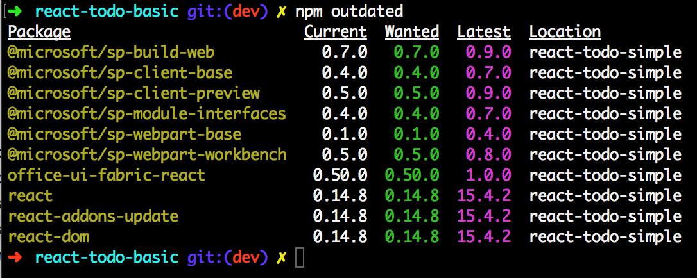
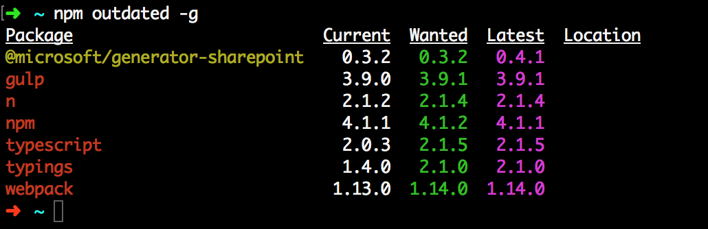

# Update SharePoint Framework packages

SharePoint client-side development tools use the [npm](https://www.npmjs.com/) package manager to manage dependencies and other required JavaScript helpers. npm is included with the Node.js install.

When you create a new client-side solution, the Yeoman generator selects dependencies for its SPFx version. Updating the globally installed generator doesn't upgrade existing projects. As you maintain a project, newer dependency versions might become available, but aren't necessarily compatible with its SPFx version or target platform.

Based on the [release notes](../roadmap.md) for a particular release or the latest package, you may decide to update your SharePoint Framework packages used in your project. SharePoint Framework packages include both the npm packages you've installed in your project, for example: [@microsoft/sp-core-library](https://www.npmjs.com/package/@microsoft/sp-core-library), and npm packages installed globally, for example: [@microsoft/generator-sharepoint](https://www.npmjs.com/package/@microsoft/generator-sharepoint).

> [!TIP]
> While it may not be required, we recommend that you update the SharePoint Framework packages often so that you can get the latest changes and fixes that have been released.

## Find outdated packages

To find the outdated packages in your client-side project, including SharePoint Framework and other packages your project depends on, run the following command in a console in the same directory as your project.

```console
npm outdated
```

The command lists the following information about the packages your project depends on. This information is looked up from the **package.json** file located in the root of your project directory and npm registry.

- Current version installed in your project
- Version requested by your project (available in **package.json**)
- Latest version available



To identify the SharePoint Framework packages, look for the package names that start with the following npm scope and prefix:

```text
@microsoft/sp-
```

Along with the SharePoint Framework packages, you may also need to update **react** and other related packages. Make sure you read the [Release Notes & Roadmap](../roadmap.md) for the specific release to infer which packages require updates.

### Use "npm outdated" with a project

SharePoint Server deployments support older SPFx versions than SharePoint Online. Check the [platform and toolchain compatibility reference](../compatibility.md) before upgrading a project.

The current generator targets SharePoint Online and doesn't prompt for older SharePoint Server targets. Use the generator and development environment appropriate to the supported server version, as described in the [generator reference](../yeoman-generator-for-spfx-intro.md#target-different-sharepoint-environments).

When you run the **npm outdated** command in a project that targets both SharePoint Online and SharePoint Server 2016, it shows you the latest versions of the SharePoint Framework packages. These versions, however, work only with SharePoint Online. If you update your solution to use these latest packages, it no longer works with SharePoint Server 2016.

When working with SharePoint Framework solutions compatible with SharePoint hosted on-premises, you should always verify which patch level the target SharePoint farm has and which version of the SharePoint Framework it supports.

## Update packages

Use your project's package manager to update dependencies and its lockfile together. With npm, **package.json** defines the requested dependency versions and **package-lock.json** records the resolved dependency tree. Manifest changes aren't ignored: `npm install` reconciles the lockfile with **package.json**, while `npm ci` fails if the two disagree.

Start with identifying which packages need updating and which newer version you want to use. It might not always be possible for you to use the latest version of the given package because it might be incompatible with other SharePoint Framework dependencies, such as TypeScript.

Follow the target release's upgrade instructions. Keep the Microsoft SPFx runtime, build-rig, plugin, and lint packages aligned with that release, and use its supported Node.js, TypeScript, and React versions. Don't independently update all `@microsoft/*` packages or use `latest` for every dependency.

For each package that you want to update, run the following command:

```console
npm install mypackage@newversion --save-exact
```

For example, if you were using [date-fns](https://date-fns.org/) version v2.9.0 and wanted to update to version 2.16.1, you would run:

```console
npm install date-fns@2.16.1 --save-exact
```

Updating the package by using npm installs the specified version of the package in your project and updates the version number in the **package.json** file dependencies and the lock file used in your project.

After the packages are installed, execute the following command to clean up any old build artifacts:

```console
heft clean
```

Review and commit both **package.json** and **package-lock.json**. Don't routinely delete the lockfile: doing so can change unrelated transitive dependencies and makes the update harder to reproduce. To verify a clean restore from the updated lockfile, use:

```console
npm ci
```

## Update your code

The Heft commands in this article apply to SPFx 1.22 and later. For older projects, use the [legacy gulp toolchain commands](sharepoint-framework-toolchain.md).

Depending on breaking API changes, you may have to update your existing project code and config files. For each release, the [release notes](../roadmap.md) highlight any such breaking changes and the modifications required to your existing code. You must make sure you update your code with those fixes.

You can always build the project to see if you've any errors and warnings by running the command in a console in your project directory:

```console
heft build
```

For a standard SPFx 1.24 project, also validate the production package with `npm run build` and test the solution in its intended hosts. Assess dependency findings using [Understanding npm audit vulnerabilities](../npm-vulnerabilities.md); don't blindly run `npm audit fix --force`.

## Update Yeoman generator

If you've installed the SharePoint Framework Yeoman generator globally, you can find out if it requires updating by running the following command:

```console
npm outdated -g
```

The command lists the following information about the packages installed globally on your machine. This information is looked up from the versions installed on your machine and the npm registry.

- Current version installed globally on your machine
- Version requested by you when you installed
- Latest version available



To identify the generator package, look for the following package name:

```console
@microsoft/generator-sharepoint
```

### Update generator package

Open your favorite console and execute the following command to update the generator to its latest published version:

```console
npm install @microsoft/generator-sharepoint@latest -g
```

The command updates the Yeoman generator for SharePoint to the latest published version along with its dependencies. You can validate this by executing the following command in the console:

```console
npm ls @microsoft/generator-sharepoint -g --depth=0
```

## See also

- [Upgrading SharePoint Framework projects (Team-based development guidance)](../team-based-development-on-sharepoint-framework.md#upgrading-sharepoint-framework-projects)
- [Upgrade SharePoint items (Provisioning SharePoint assets)](provision-sharepoint-assets.md#upgrade-sharepoint-items)
- [SharePoint Framework Overview](../sharepoint-framework-overview.md)
