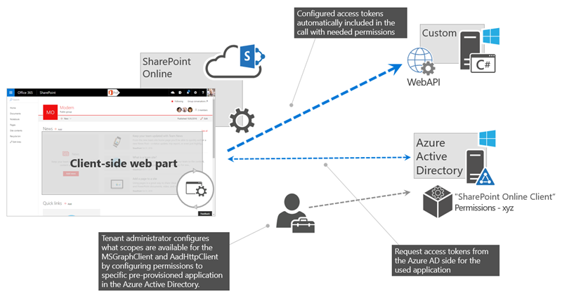
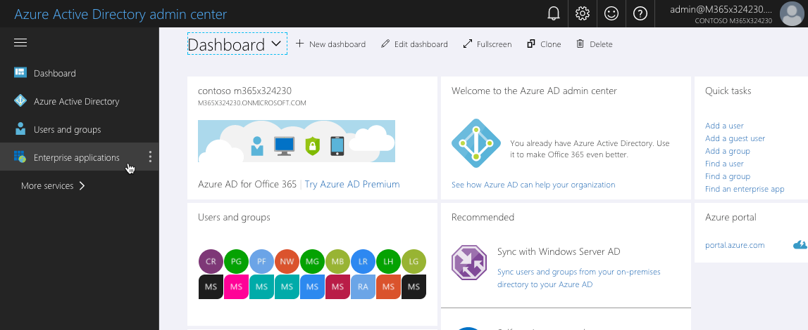
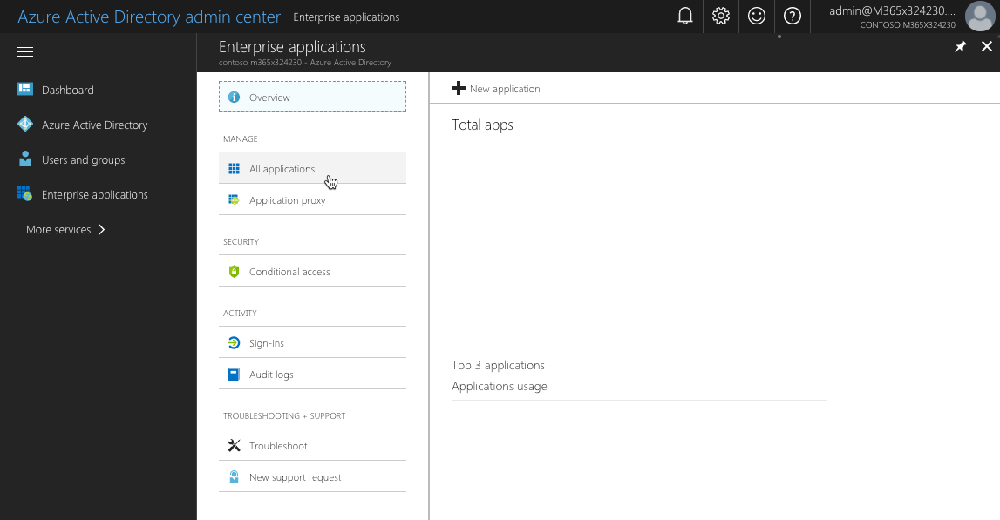
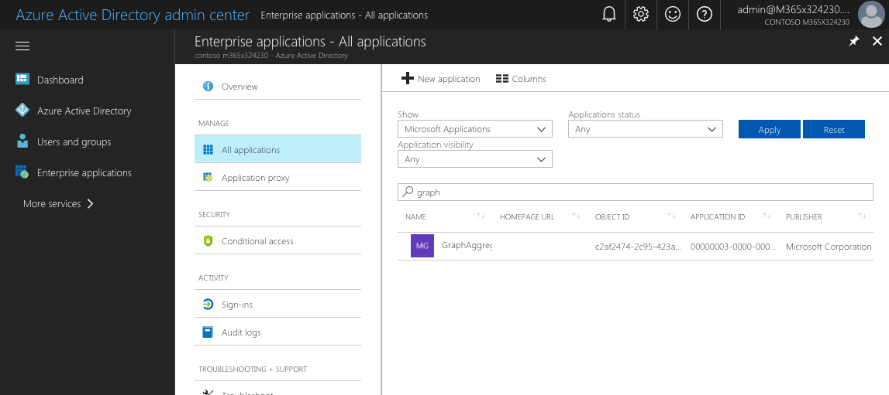
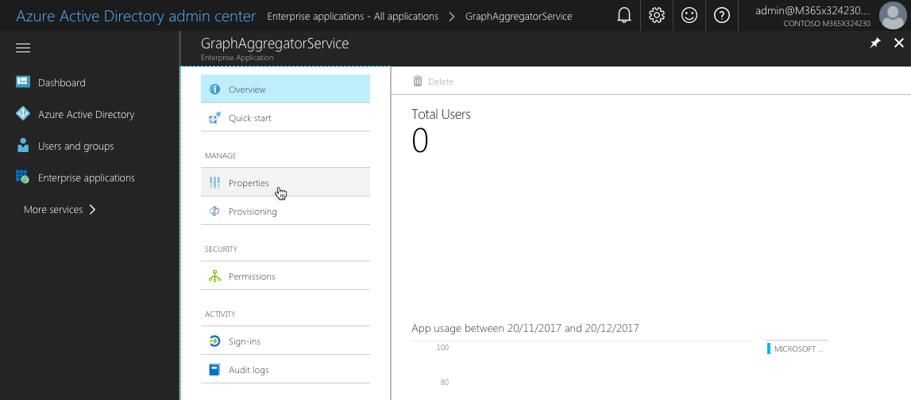
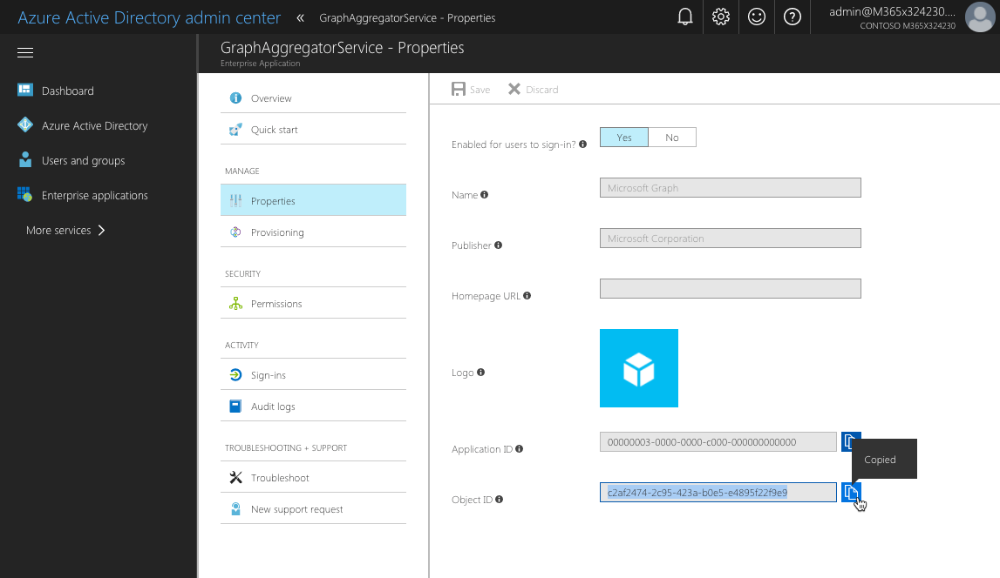

# Connect to Microsoft Entra ID-secured APIs in SharePoint Framework solutions

When building SharePoint Framework solutions, you might need to connect to an API secured by Microsoft Entra ID. Specify the required delegated permissions in your solution and have an administrator with the appropriate role review them. **AadHttpClient** handles token acquisition for supported SPFx scenarios so you don't need to implement the OAuth flow yourself.

> [!IMPORTANT]
> The administrator role required for API approval depends on the target API. Approval for Microsoft Graph or other Microsoft APIs requires a **Global Administrator**; for third-party APIs registered in the tenant, an **Application Administrator** is sufficient. A SharePoint Administrator role alone doesn't establish authority to grant every API permission. See [Manage access to Microsoft Entra ID-secured APIs](/sharepoint/api-access).

## Web API permissions overview

Entra ID secures a number of resources, from Microsoft 365 to custom line-of-business applications built by the organization. To connect to these resources, applications must obtain a valid access token that grants them access to a particular resource. Applications can obtain an access token as part of the [OAuth authorization flow](/azure/active-directory/develop/active-directory-protocols-oauth-code).

Client-side applications cannot securely store client secrets. Use the SPFx-provided authentication clients rather than embedding secrets or implementing a separate token flow.

Use **AadHttpClient** for Microsoft Entra ID-secured APIs and [**MSGraphClientV3**](use-msgraph.md) for Microsoft Graph. The underlying authentication implementation is managed by SharePoint and can differ by SPFx version and host; older implicit-flow descriptions aren't a universal statement about current SPFx authentication.

> [!NOTE]
> Use **AadHttpClient** or **MSGraphClientV3** for the supported SPFx authentication integration rather than adding your own MSAL instance to replace it. For cookie restrictions, interactive sign-in, and the popup event, see [Working with AadTokenProvider](use-aadtokenprovider.md). Browser popup restrictions and tenant settings can affect sign-in; don't assume silent authentication always succeeds.

As part of the SharePoint Framework, a specific process is defined for how developers can request permissions and administrators can manage permissions to resources secured with Entra ID. The following schema illustrates this process.



Developers list required resources and permission scopes in **config/package-solution.json**. Deploying the package to the app catalog creates permission requests for an appropriately authorized administrator to approve or reject.

For the shared SPFx permission model, grants aren't isolated to the solution that requested them. The [SharePoint API access documentation](/sharepoint/api-access) identifies the **SharePoint Online Client Extensibility Web Application Principal** as the recipient of delegated permissions. Older guidance abbreviates this name as **SharePoint Online Client Extensibility**. Manage requests and grants through SharePoint's supported API access controls rather than selecting or modifying a principal solely by its display name.

## Discover available applications and permissions

The target Entra ID that secures your Microsoft 365 tenant determines which applications you can request permissions for in your solution. The list of available applications might depend on the Microsoft 365 license that the organization is using and which line-of-business applications they registered in Entra ID. If you have sufficient permissions, there are several ways that you can see which applications and permission scopes are available in your tenant.

### Use the Azure portal or Entra ID portal

One way to see the available applications in Entra ID is by navigating to the [Azure portal](https://portal.azure.com/) or to the [Entra ID portal](https://entra.microsoft.com).

1. In the Entra ID admin center, in the left navigation, select the **Enterprise applications** link.

    

1. On the **Enterprise applications** blade, in the **Manage** group, select the **All applications** link.

    

1. To quickly find the application to which you want to connect, you can filter the overview either by application type (_Microsoft Applications_ or _Enterprise Applications_), or you can search for it by using its name or ID.

      For example, if you want to request additional permissions to the Microsoft Graph, in the search box, you would search for `graph`.

    

1. After you find the application, select it to get additional information. On the application's blade, in the **Manage** group, select **Properties** to open the application's properties.

    

1. From the list of properties, copy the value of the **Object ID** property, which you need to request additional permission scopes to the Microsoft Graph. Instead, you can copy the application's **Name** and use it in the permission request instead.

    

 > [!NOTE]
 > While the **Object ID** is unique for each tenant, the application's **Name** is the same across all tenants. If you want to build your solution once and deploy it to different tenants, you should use the application's **Name** when requesting additional permissions in your solution.

### Use Azure PowerShell

Use the supported [Azure PowerShell Az module](/powershell/azure/install-az-ps) and [Get-AzADServicePrincipal](/powershell/module/az.resources/get-azadserviceprincipal) reference to discover service principals in your tenant. Older examples using `Login-AzureRmAccount` and `Get-AzureRmADServicePrincipal` target the legacy AzureRM module and aren't current setup instructions.

### Use Azure CLI

Use the [Azure CLI](/cli/azure/install-azure-cli) and its [az ad sp list](/cli/azure/ad/sp#az-ad-sp-list) command reference to discover service principals. Azure CLI command identifiers retain `ad`; don't replace that identifier with the product name "Entra ID".

### Get the list of permission scopes exposed by the application

Each Entra ID application exposes a number of permission scopes. These permission scopes often relate to specific resources or operations inside the application. To get the list of permissions available for the application you would like to connect to, consult its documentation. For the list of permission scopes available in the Microsoft Graph, see [Microsoft Graph permissions reference](/graph/permissions-reference).

## Request permissions to an Entra ID application

If your SharePoint Framework solution requires permissions to specific resources secured with Entra ID, such as Microsoft Graph or enterprise applications, you can specify these resources along with the necessary permissions in the configuration of your solution.

1. In your SharePoint Framework project, open the **config/package-solution.json** file.
1. To the `solution` property, add the `webApiPermissionRequests` property that lists all the resources and corresponding permissions that your solution needs.

    The following is an example of a SharePoint Framework solution requesting access to read user calendars by using the Microsoft Graph:

    ```json
    {
      "$schema": "https://developer.microsoft.com/json-schemas/spfx-build/package-solution.schema.json",
      "solution": {
        "name": "spfx-graph-client-side-solution",
        "id": "5d16587c-5e87-44d7-b658-1148988f212a",
        "version": "1.0.0.0",
        "includeClientSideAssets": true,
        "skipFeatureDeployment": true,
        "webApiPermissionRequests": [
          {
            "resource": "Microsoft Graph",
            "scope": "Calendars.Read"
          }
        ]
      },
      "paths": {
        "zippedPackage": "solution/spfx-graph.sppkg"
      }
    }
    ```

    > [!NOTE]
    > For the value of the `resource` property, you need to specify the `displayName` of the application to which you want to request permissions. If you specify the resource using its `objectId`, you will get an error when trying to approve the permission request.

1. If you want to request multiple permission scopes for the given resource, specify each scope in a separate entry, for example:

    ```json
    {
      "$schema": "https://developer.microsoft.com/json-schemas/spfx-build/package-solution.schema.json",
      "solution": {
        "name": "spfx-graph-client-side-solution",
        "id": "5d16587c-5e87-44d7-b658-1148988f212a",
        "version": "1.0.0.0",
        "includeClientSideAssets": true,
        "skipFeatureDeployment": true,
        "webApiPermissionRequests": [
          {
            "resource": "Microsoft Graph",
            "scope": "Calendars.Read"
          },
          {
            "resource": "Microsoft Graph",
            "scope": "User.ReadBasic.All"
          }
        ]
      },
      "paths": {
        "zippedPackage": "solution/spfx-graph.sppkg"
      }
    }
    ```

1. When this solution is deployed to the SharePoint app catalog, it prompts the administrator to verify the requested permissions and either grant or deny them.

    > [!NOTE]
    > No matter if the administrator denies or approves the requested permissions, the solution can be deployed and used on sites. When building solutions that require additional permissions, you should never assume that the requested permissions have been granted.

### Requesting permissions to Entra ID applications in another tenant

The previous steps address adding a permission request to an Entra ID application defined in the same Entra ID tenant as your SharePoint Online tenant. However, when you want to grant a permission for an Entra ID application defined in another tenant (a multitenant Entra ID application), you must first add a service principal for that Entra ID application to your tenant.

> [!NOTE]
> This capability was added in the [SPFx v1.15.2 release](release-1.15.2.md).

> [!IMPORTANT]
> Entra ID applications have two types of principals. The application object is created when the Entra ID app is created; it is a *global* representation of the application across all tenants.
>
> Permissions are granted to service principals, which are the *local* representation of the app for use in a specific tenant.
>
> When you create an Entra ID application in a tenant, both the application object & service principal are created in that tenant. But when you want to use the Entra ID application in another tenant, you must create a service principal for that application in your tenant.
>
> To learn more about Entra ID application principals, objects, and service principals, see: [Application and service principal objects in Entra ID](/azure/active-directory/develop/app-objects-and-service-principals).
>
> To learn more about single and multitenant Entra ID applications, see: [Tenancy in Entra ID](/azure/active-directory/develop/single-and-multi-tenant-apps).

When you want to grant SharePoint Online permissions to an Entra ID application defined to another tenant, the service principal needs to already exist on the tenant where SharePoint Online operates. Prior to SPFx v1.15.2, SharePoint expected the service principal to already exist. But SPFx v1.15.2 introduced a way to register the service principal during the permission request approval process.

To do this, you must include two additional properties in the SPFx project's **package-solution.json** file's `webApiPermissionRequests` entry:

```json
{
  "$schema": "https://developer.microsoft.com/json-schemas/spfx-build/package-solution.schema.json",
  "solution": {
  ..
  "webApiPermissionRequests": [
    {
      "resource": "<API name as it's registered in Entra ID>",
      "scope": "<required permission scope>",
      "appId": "<GUID>",
      "replyUrl": "<URL>"
    }
  ]
  ..
```

The two additional properties are:

- `appId`: This is the application object's ID for which a service principal will be created in the tenant.
- `replyUrl`: This is the URL used by Entra ID during the consent and registration experience of the permission request.

> [!IMPORTANT]
> If either `appid` or `replyUrl` is included, they are both required. In other words, include both properties (*if you're referencing an Entra ID app registered in another tenant from your SharePoint Online tenant*) or neither property (*if you're referencing an Entra ID app registered in the same tenant as your SharePoint Online tenant*).

## Manage permission requests

When you deploy SharePoint Framework solutions that request permissions to Entra ID applications, administrators are prompted to manage the permission request provided with the solution. Permission requests can be managed in several ways.

### Manage permissions in the new SharePoint admin center

To learn how to use the API access page in the new SharePoint admin center, see [Manage access to Entra ID-secured APIs](/sharepoint/api-access).

### Manage permissions with PowerShell

Administrators can also use the SharePoint Online Management Shell to manage permissions and requests. The required role depends on the operation and target API; follow the [API access requirements](/sharepoint/api-access).

- To *view all pending permission requests*, use the **Get-SPOTenantServicePrincipalPermissionRequests** cmdlet. For each permission request, the cmdlet lists its ID (required to either approve or deny the request), the resource for which permissions have been requested, and the requested permissions.

  > [!NOTE]
  > SharePoint doesn't verify if the requested permissions have already been granted or not, so before approving or rejecting a permission request, check which permissions have already been granted in your tenant.

- To *approve the specific permission request*, use the **Approve-SPOTenantServicePrincipalPermissionRequest -RequestId \<Guid\>** cmdlet, specifying the ID of the permission request that you want to approve.

    > [!NOTE]
    > If you try to approve a request for a permission that has already been granted, you get an error.

- To *deny a permission request* (if the requested permission has already been granted, or the request is against your organizational policies), use the **Deny-SPOTenantServicePrincipalPermissionRequest -RequestId \<Guid\>** cmdlet, specifying the ID of the permission request that you want to deny.

    > [!NOTE]
    > Denying a permission request issued by a SharePoint Framework application doesn't prevent that application from being deployed in the app catalog and installed on sites.

- To *view which permissions have been granted* in your tenant, use the **Get-SPOTenantServicePrincipalPermissionGrants** cmdlet. For each grant, the cmdlet displays the following information:
  - **ClientId**: The objectId of the service principal granted consent to impersonate the user when accessing the resource (represented by the resourceId).
  - **ConsentType**: Whether consent was provided by the administrator for the organization or whether consent was provided by an individual. The possible values are "AllPrincipals" or "Principal".
  - **ObjectId**: The unique identifier for the permission grant.
  - **Resource**: The resource to which access has been granted.
  - **ResourceId**: The objectId of the resource service principal to which access has been granted.
  - **Scope**: The value of the scope claim that the resource application should expect in the OAuth 2.0 access token.

- To *revoke a previously granted permission*, use the **Revoke-SPOTenantServicePrincipalPermission -ObjectId \<String\>** cmdlet. In the **ObjectId** parameter, you should specify the objectId of the grant that you want to revoke, which you can obtain by using the **Get-SPOTenantServicePrincipalPermissionGrants** cmdlet.

    > [!NOTE]
    > Revoking a permission doesn't trigger any changes to the app catalog or any of the deployed applications. The only consequence of revoking a permission is that any application used in the tenant will not be able to connect to the resources for which the permission has been revoked.

### Manage permissions using the CLI for Microsoft 365

Administrators can use the [CLI for Microsoft 365](https://aka.ms/o365cli) to manage permissions and requests, subject to the same API approval requirements.

[!INCLUDE [pnp-o365cli](../../includes/snippets/open-source/pnp-o365cli.md)]

- To *view all pending permission requests*, use the **[spo serviceprincipal permissionrequest list](https://pnp.github.io/cli-microsoft365/cmd/spo/serviceprincipal/serviceprincipal-permissionrequest-list/)** command. For each permission request, the command lists its ID (required to either approve or deny the request), the resource for which permissions have been requested, and the requested permissions.

    > [!NOTE]
    > SharePoint doesn't verify if the requested permissions have already been granted or not, so before approving or rejecting a permission request, check which permissions have already been granted in your tenant.

- To *approve a specific permission request*, use the **[spo serviceprincipal permissionrequest approve](https://pnp.github.io/cli-microsoft365/cmd/spo/serviceprincipal/serviceprincipal-permissionrequest-approve/)** command, specifying the ID of the permission request that you want to approve.

    > [!NOTE]
    > If you try to approve a request for a permission that has already been granted, you get an error.

- To *deny a permission request* (if the requested permission has already been granted, or the request is against your organizational policies), use the **[spo serviceprincipal permissionrequest deny](https://pnp.github.io/cli-microsoft365/cmd/spo/serviceprincipal/serviceprincipal-permissionrequest-deny/)** command, specifying the ID of the permission request that you want to deny.

    > [!NOTE]
    > Denying a permission request issued by a SharePoint Framework application doesn't prevent that application from being deployed in the app catalog and installed on sites.

- To *view which permissions have been granted* in your tenant, use the **[spo serviceprincipal grant list](https://pnp.github.io/cli-microsoft365/cmd/spo/serviceprincipal/serviceprincipal-grant-list/)** command. For each grant, the command displays the following information:
  - **ObjectId**: The unique identifier for the permission grant.
  - **Resource**: The resource to which access has been granted.
  - **ResourceId**: The objectId of the resource service principal to which access has been granted.
  - **Scope**: The value of the scope claim that the resource application should expect in the OAuth 2.0 access token.

- To *revoke a previously granted permission*, use the **[spo serviceprincipal grant revoke](https://pnp.github.io/cli-microsoft365/cmd/spo/serviceprincipal/serviceprincipal-grant-revoke/)** command. In the **grantId** parameter, specify the objectId of the grant that you want to revoke, which you can obtain by using the **spo serviceprincipal grant list** command.

    > [!NOTE]
    > Revoking a permission doesn't trigger any changes to the app catalog or any of the deployed applications. The only consequence of revoking a permission is that any application used in the tenant will not be able to connect to the resources for which the permission has been revoked.

## Connect to Entra ID applications using the AadHttpClient

Introduced in v1.4.1, the SharePoint Framework simplifies connecting to APIs secured with Entra ID. Using the new **AadHttpClient**, you can easily connect to APIs secured with Entra ID without having to implement authentication and authorization yourself.

Internally, the **AadHttpClient** implements the Entra ID OAuth flow, leveraging Microsoft identity platform authentication libraries by using the **SharePoint Online Client Extensibility** service principal to obtain a valid access token. The **SharePoint Online Client Extensibility** service principal is provisioned by Microsoft and is available in the Entra ID of all Microsoft 365 tenants.

1. To use the **AadHttpClient** in your SharePoint Framework solution, add the following `import` clause in your main web part file:

    ```typescript
    import { AadHttpClient, HttpClientResponse } from '@microsoft/sp-http';
    ```

1. Get a new instance of the **AadHttpClient**, passing the resource to which you want to connect as parameters:

    ```typescript
    export default class HelloWorldWebPart extends BaseClientSideWebPart<IHelloWorldWebPartProps> {
      public render(): void {
        // ...

        this.context.aadHttpClientFactory
          .getClient('https://contoso.azurewebsites.net')
          .then((client: AadHttpClient): void => {
            // connect to the API
          });
      }

      // ...
    }
    ```

    > [!NOTE]
    > Each instance of the **AadHttpClient** is linked to a specific resource, which is why you need to create a new instance of the client for each resource that you want to connect to.

1. After you instantiate the **AadHttpClient** for your resource, you can issue a web request to communicate with your API; in this example, the API returns a list of orders represented by the custom **Order** interface defined elsewhere in the project:

    ```typescript
    export default class HelloWorldWebPart extends BaseClientSideWebPart<IHelloWorldWebPartProps> {
      public render(): void {
        // ...

        this.context.aadHttpClientFactory
          .getClient('https://contoso.azurewebsites.net')
          .then((client: AadHttpClient): void => {
            client
              .get('https://contoso.azurewebsites.net/api/orders', AadHttpClient.configurations.v1)
              .then((response: HttpClientResponse): Promise<Order[]> => {
                return response.json();
              })
              .then((orders: Order[]): void => {
                // process data
              });
          });
      }

      // ...
    }
    ```

## Considerations

Following are some considerations that you should take into account when working with web API permissions.

### Request permissions via SharePoint Framework solutions

For the solution-based workflow described here, deploy a package (**\*.sppkg**) containing `webApiPermissionRequests` to the app catalog. An administrator with the required role can then approve or reject each request through the supported [API access controls](/sharepoint/api-access).

### Granted permissions apply to the entire tenant

In the shared SPFx permission model, approved delegated permissions can be used by other components and custom scripts using the same principal in the tenant. They aren't restricted to the solution that requested them and don't grant application-only access or permissions beyond those of the signed-in user.

### Removing the solution doesn't revoke permissions

Removing the solution that initially requested the particular permission doesn't revoke the granted permission. Administrators have to manually revoke permissions granted through SharePoint Framework application requests.

### Revoking previously granted permissions doesn't invalidate issued access tokens

Revoking previously granted permissions doesn't invalidate access tokens issued to users. Instead, these access tokens remain valid until they expire.

### Permission request doesn't affect the solution deployment

No matter if the administrator denies or approves permissions requested by the solution, the solution can be deployed and used on sites. When building solutions that require additional permissions, you should never assume that the requested permissions have been granted.

### Control the SharePoint Online Client service principal

All permissions granted through web API requests are stored with the **SharePoint Online Client Extensibility** Entra ID application. If administrators don't want developers to use the web API request model and the **MSGraphClient** and **AadHttpClient** in their solutions, they can disable the **SharePoint Online Client Extensibility** service principal through PowerShell by using the **Disable-SPOTenantServicePrincipal** cmdlet.

The service principal can be re-enabled by using the **Enable-SPOTenantServicePrincipal** cmdlet. Instead, it's also possible to enable and disable the **SharePoint Online Client Extensibility** service principal through the CLI for Microsoft 365 by using the **[spo serviceprincipal set](https://pnp.github.io/cli-microsoft365/cmd/spo/serviceprincipal/serviceprincipal-set/)** command.

> [!NOTE]
> The **SharePoint Online Client Extensibility** principal is fully controlled by SharePoint via the API access page in the SharePoint admin center. Making any changes directly to the principal in the Microsoft Entra admin center can result in unpredictable behaviors and is not supported.  
