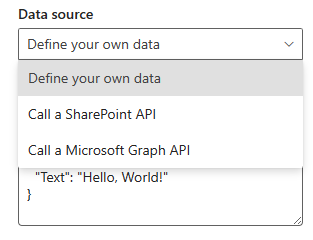
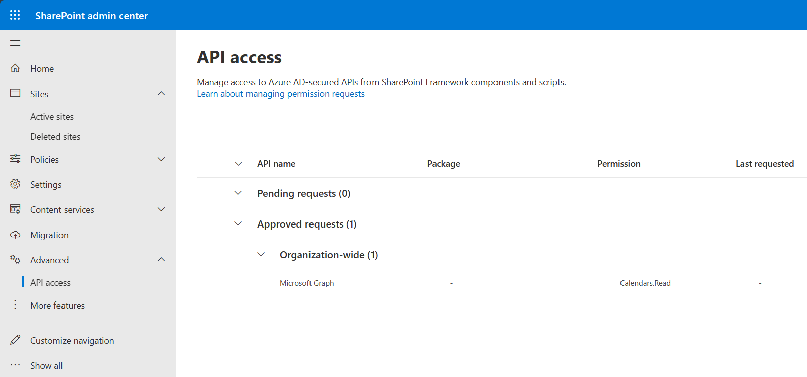
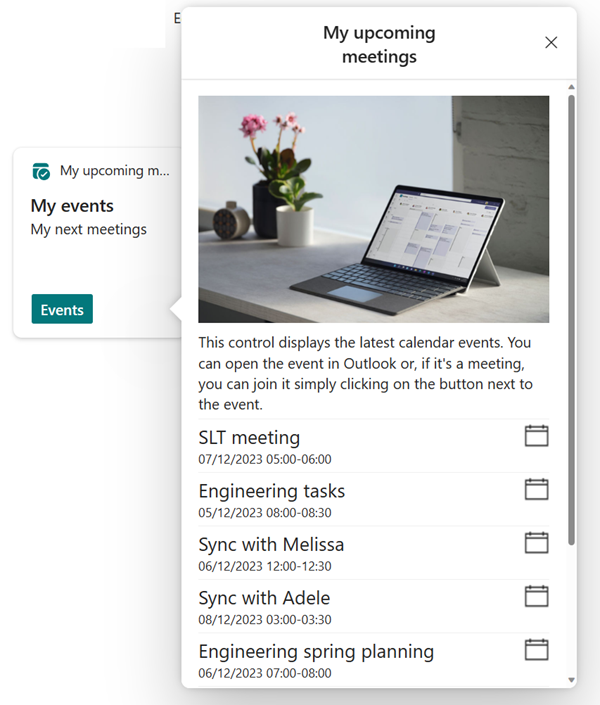

# Overview of Viva Connections Card Designer advance API features

Advance API features for the Viva Connections Card Designer enable the dashboard editors to create API powered Quick View experiences without actual code. This new option is supported with all the different form factors or Viva Connections dashboard - mobile, tablet and desktop.

> [!IMPORTANT]
> The screenshots below show the original Card Designer API experience introduced in 2023. For current dashboard-authoring guidance, see [Design your own card with a Quick View](/viva/connections/create-dashboard#design-your-own-card-with-a-quick-view). Check your tenant's configuration rather than relying on the original rollout schedule.

## Enabling feature in the tenant

Have a SharePoint administrator check the tenant's current configuration and the supported settings in the [`Set-SPOTenant` reference](/powershell/module/microsoft.online.sharepoint.powershell/set-spotenant). Don't assume the feature is enabled or disabled in every tenant. The following example enables the setting; it doesn't inspect its current value.

```powershell
Set-SPOTenant -IsDataAccessInCardDesignerEnabled $true
```

> [!IMPORTANT]
> Use a current [SharePoint Online Management Shell](/powershell/sharepoint/sharepoint-online/connect-sharepoint-online) and consult the [`Set-SPOTenant` reference](/powershell/module/microsoft.online.sharepoint.powershell/set-spotenant) for the setting. The original minimum module version was 16.0.24308.12000; it isn't a recommendation to install that historical build.

The original Card Designer UI displayed `Advance features have not been enabled by an administrator` when the setting wasn't enabled. The current UI and message wording can differ.

The following historical screenshot illustrates the API options in the **Data source** selection:



## Managing available API permissions

Enabling the tenant setting doesn't grant API permissions. Have an administrator review the required permissions through **API access** in the SharePoint admin center, following the supported [SharePoint Framework API permission-management guidance](../../../use-aadhttpclient.md). Check the required administrator role and tenant-wide impact before approving access.

Request only the permissions needed by the API operation. Consent doesn't give a signed-in user access to data they aren't authorized to read. If a request fails, investigate the current authentication or consent error using that guidance rather than editing a service principal based on the historical screenshots.



## Using dynamic API data in the Card Designer

When the needed API permissions are available, dashboard designer can use the API features to get dynamic content based on the user identity. As an example, you could use the following Microsoft Graph endpoint to get the following events for the particular user.

```text
https://graph.microsoft.com/v1.0/me/events?$take=5&$select=id,webLink,subject,start,end,location
```

Combining that API call with a custom adaptive card presentation, you could, for example,  present the user's upcoming meetings with following Quick View rendering.



> [!TIP]
> You can use the [Microsoft Graph Explorer](https://developer.microsoft.com/graph/graph-explorer) to see the different available APIs from Microsoft Graph and their output in JSON. Using that output with [Adaptive Card Designer](https://adaptivecards.io/designer/), you can easily create powerful experiences with the Card Designer advance API features.

## References

- [YouTube - Introduction to new advance API features in Viva Connections Card Designer](https://www.youtube.com/watch?v=NjZj1F6D6jw)
- [Viva Connections Card designer](/viva/connections/create-dashboard#design-your-own-card-with-a-quick-view)
- [Microsoft Graph Explorer](https://developer.microsoft.com/graph/graph-explorer)
- [Adaptive Card Designer](https://www.adaptivecards.io/designer/)
- [SharePoint Online Management Shell](/powershell/sharepoint/sharepoint-online/connect-sharepoint-online)
