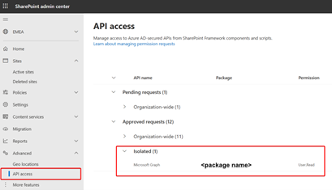

# SharePoint Framework domain isolated web parts retirement for SharePoint Online

> [!IMPORTANT]
> Domain isolated web parts in SharePoint Framework (SPFx) were retired on April 2, 2026 and no longer work in SharePoint Online. This applies to all environments, including government clouds and the U.S. Department of Defense. There is no option to extend their use beyond the retirement date.

Existing pages with domain isolated web parts can display an error instead of the web part's functionality. Migrate affected solutions to regular SPFx web parts using the guidance below. Regular SPFx web parts are not retired by this change.

## Timeline

Date | Action
-----|-------
April 2, 2025 | Domain isolated web parts were turned off for newly created tenants.
April 2, 2026 | Domain isolated web parts were retired for all tenants.

## Overview

Domain isolated web parts ran in a separate domain from the host page to isolate API permissions for a solution. The feature had limited usage and performance implications from running in a dedicated domain. The [historical architecture overview](./isolated-web-parts.md) is retained to help with migration.

To understand whether you have installed domain isolated web parts and granted permissions you can verify if the [SharePoint admin center API access page](/sharepoint/api-access) contains permissions listed under the “Isolated” grouping.



If you see permissions listed under **Isolated** then use the instructions below to understand more about the deployed domain isolated web parts. This script will create two CSV files:

- **Solutions.csv**: this file contains an overview of the solutions that contain domain isolated web parts
- **Pages.csv**: this file contains an entry per page holding one of the domain isolated web parts

To use this script follow these steps:

1. Copy PowerShell script file contents (end of this page) and save it as **Find-DomainIsolatedWebparts.ps1** on your local drive.
1. [Install PnP PowerShell](https://pnp.github.io/powershell/articles/installation.html) in case that is not yet available.
1. [Configure PnP PowerShell to authenticate with Microsoft Entra](https://pnp.github.io/powershell/articles/authentication.html#setting-up-access-to-your-own-azure-ad-app), preferably configure for using application permissions as that’s required to check for domain isolated web parts across the whole tenant. If you have a Microsoft Entra application configured with a cert and the SharePoint Sites.Read.All permission you can just use that, if not follow below guidance to create such an application. Replace the values between `<>` with relevant values for your tenant:

    ```PowerShell
    Register-PnPAzureADApp -ApplicationName FindDomainIsolatedWebparts -Tenant <contoso.onmicrosoft.com> -Store CurrentUser -SharePointApplicationPermissions "Sites.Read.All" -Username "<joe@contoso.onmicrosoft.com>" -Interactive
    ```

1. Connect to your tenant app catalog using the client id and certificate. Replace the values between `<>` with relevant values for your tenant. If you don’t know your app catalog site URL you can connect to an arbitrary site in your tenant and then use **Get-PnPTenantAppCatalogUrl**:

    ```PowerShell
    Connect-PnPOnline <https://contoso.sharepoint.com/sites/appcatalog> -ClientId <5be692c9-0a1a-4f07-b3e8-7b79f1582375> -Thumbprint <B49C5854E08EA0D401C4604C870A27167B07BD7D> -tenant <contoso.onmicrosoft.com>
    ```

1. Run the script to discover domain isolated web part usage:

    ```PowerShell
    .\Find-DomainIsolatedWebparts.ps1
    ```

## Call to Action Guidance

If your SPFx solutions still contain domain isolated web parts, migrate them to regular web parts to restore their functionality. Do not create new domain isolated solutions.

To migrate your web parts, set `isDomainIsolated` to `false` in **config/package-solution.json**, increment the solution version, rebuild, and redeploy your solution.

Review the API permissions previously listed under **Isolated** on the SharePoint admin center **API access** page. Request and approve only the permissions the migrated solution needs under **Organization-wide**. See [Manage access to Microsoft Entra ID-secured APIs](/sharepoint/api-access).

> [!IMPORTANT]
> Organization-wide permissions are shared with other SPFx solutions and scripts in the tenant; they do not preserve the retired feature's per-solution isolation. Review your authorization design and least-privileged permissions before approving these grants.

Test affected pages, API calls, and property panes after deployment. Remove obsolete isolated grants and dedicated Microsoft Entra applications only after confirming that they are no longer needed.

## PowerShell script to discover domain isolated web part usage

```PowerShell
<#
.Synopsis

    Detects solutions containing domain isolated web parts and the SharePoint pages holding those web parts.
    You need to install a recent PnP PowerShell version (July 2023 or higher) to use this script.

    This script generates two CSV files in case domain isolated web parts are found:
        - solutions.csv: contains the solutions with domain isolated web parts
        - pages.csv: contains the pages holding the domain isolated web parts

    Optionally you can skip the search for pages with domain isolated web parts by using the -SkipPages parameter.

    This script uses search to find the relevant pages, so when you use Connect-PnPOnline with delegated permissions you can only see
    the pages that the current account has access to. For a complete search use Connect-PnPOnline with application permissions.

.Example

    Connect-PnPOnline https://contoso.sharepoint.com/sites/appcatalog -ClientId 0b6a3858-dbbb-489b-b63d-1905426222f8 -Tenant contoso.onmicrosoft.com -CertificatePath "c:\certificate.pfx"
    Find-DomainIsolatedWebparts.ps1 -SkipPages $false

.Notes

    Useful references:
        - https://aka.ms/retirement/domainisolatedwebparts/support
        - https://aka.ms/sppnp-powershell
#>

[CmdletBinding()]
param (
    [Parameter(Mandatory = $false, HelpMessage = "Skip searching for pages with domain isolated web parts.")]
    [bool]$SkipPages = $false
)
begin
{
    # Verify there's an app catalog and that we're connected to it
    $appCatalog = Get-PnPTenantAppCatalogUrl

    if ($null -eq $appCatalog)
    {
        Write-Host "No app catalog found, exiting as there can't be any domain isolated web parts without a configured app catalog!" -ForegroundColor Green
        exit
    }

    if ($appCatalog -ne (Get-PnPConnection).Url.TrimEnd("/"))
    {
        Write-Host "You need to connect to your tenant app catalog first. Use Connect-PnPOnline to connect to $appCatalog" -ForegroundColor Red
        exit
    }
}
process
{
    # check for apps that use domain isolation
    $solutionsWithDomainIsolatedWebParts = Get-PnPListItem -List AppCatalog -Query "<View><ViewFields><FieldRef Name='Title'/><FieldRef Name='AppPublisher'/><FieldRef Name='AppShortDescription'/><FieldRef Name='AppVersion'/><FieldRef Name='IsClientSideSolutionDeployed'/><FieldRef Name='SkipFeatureDeployment'/><FieldRef Name='UniqueSolutionId'/><FieldRef Name='IsolatedDomain'/></ViewFields><Query><Where><IsNotNull><FieldRef Name='IsolatedDomain'/></IsNotNull></Where></Query></View>"

    if ($null -eq $solutionsWithDomainIsolatedWebParts)
    {
        Write-Host "No domain isolated web parts found!" -ForegroundColor Green
        exit
    }

    $solutionsToExport = @()
    $pagesToExport = @()

    if ($SkipPages -eq $false -and [string]::IsNullOrEmpty((Get-PnPConnection).Certificate.Thumbprint))
    {
        Write-Host
        Write-Host "WARNING: You'll be searching for pages containing domain isolated web parts using delegated permissions. Only the pages that the current account can access will be returned. For a complete search use Connect-PnPOnline with applicaiton permissions" -ForegroundColor Yellow
        Write-Host
    }

    # inspect the manifest to find the web part ids
    foreach ($domainIsolatedSolution in $solutionsWithDomainIsolatedWebParts) {

        if ($domainIsolatedSolution.FieldValues.IsClientSideSolutionDeployed -eq $false)
        {
            Write-Host "Skipping solution ""$($domainIsolatedSolution.FieldValues.Title)"" as it is not deployed" -ForegroundColor Yellow
            continue
        }

        Write-Host "Solution ""$($domainIsolatedSolution.FieldValues.Title)"" contains domain isolated web parts!" -ForegroundColor Green
        Write-Host "Inspecting solution ""$($domainIsolatedSolution.FieldValues.Title)"" with id $($domainIsolatedSolution.FieldValues.UniqueSolutionId)..." -ForegroundColor Green

        $solutionsToExport += [pscustomobject]@{
            'Title' = $domainIsolatedSolution.FieldValues.Title;
            'Solution Id' = $domainIsolatedSolution.FieldValues.UniqueSolutionId;
            'Publisher' = $domainIsolatedSolution.FieldValues.AppPublisher;
            'Description' = $domainIsolatedSolution.FieldValues.AppShortDescription;
            'Version' = $domainIsolatedSolution.FieldValues.AppVersion;
            'Skip feature deployment' = $domainIsolatedSolution.FieldValues.SkipFeatureDeployment;
            'Isolated domain' = $domainIsolatedSolution.FieldValues.IsolatedDomain;
        }

        if ($SkipPages -eq $true)
        {
            Write-Host "Skipping search for pages with domain isolated web parts" -ForegroundColor Yellow
            continue
        }

        $components = Get-PnPListItem -List "Lists/ComponentManifests" -Query "<View><ViewFields><FieldRef Name='ClientComponentName'/><FieldRef Name='ClientComponentId'/></ViewFields><Query><Where><Eq><FieldRef Name='SolutionId'/><Value Type='Text'>$($domainIsolatedSolution.FieldValues.UniqueSolutionId)</Value></Eq></Where></Query></View>"

        if ($null -ne $components) {

            foreach($component in $components)
            {
                Write-Host "Searching for pages using component: ""$($component.FieldValues.ClientComponentName)"" with id $($component.FieldValues.ClientComponentId)..." -ForegroundColor Blue

                #Perform a search to find the pages hosting these web parts
                $pages = Submit-PnPSearchQuery -Query "FileExtension:aspx SPFxExtensionJson:$($component.FieldValues.ClientComponentId)" -All -RelevantResults | Select-Object SPWebUrl,OriginalPath

                if ($null -ne $pages) {
                    foreach($page in $pages)
                    {
                        Write-Host $page.OriginalPath

                        $pagesToExport += [pscustomobject]@{
                            'Title' = $domainIsolatedSolution.FieldValues.Title;
                            'Publisher' = $domainIsolatedSolution.FieldValues.AppPublisher;
                            'Component' = $component.FieldValues.ClientComponentName;
                            'Component Id' = $component.FieldValues.ClientComponentId;
                            'Site' = $page.SPWebUrl;
                            'Page' = $page.OriginalPath;
                        }
                    }
                }

                Write-Host("-" * 40) -ForegroundColor Blue
            }
        }
    }

    $solutionsToExport | Export-CSV "solutions.csv" -NoTypeInformation

    if ($SkipPages -eq $false)
    {
        $pagesToExport | Export-CSV "pages.csv" -NoTypeInformation
    }

}
```
