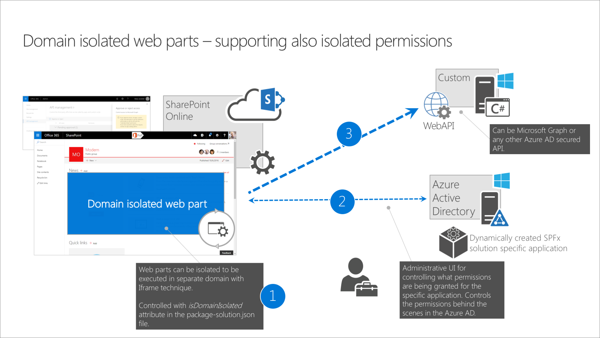

# Isolated web parts (retired)

> [!IMPORTANT]
> Domain isolated web parts were retired in SharePoint Online on April 2, 2026 and no longer work. They were disabled for newly created tenants on April 2, 2025. Do not create or deploy solutions that use domain isolation. Follow the [retirement and migration guidance](./isolated-web-parts-retirement.md) to move existing solutions to regular SharePoint Framework web parts.

This article preserves the architecture and behavior of the retired feature to help you identify and migrate existing solutions. It is not guidance for new development.

## Why isolated web parts existed

SharePoint Framework API access permissions allow scripts in a tenant to access approved APIs on behalf of the current user. Domain isolated web parts were designed to limit access to Microsoft Entra ID-secured APIs to a specific SPFx solution rather than sharing those permissions with other scripts.

Regular SPFx web parts do not provide the same per-solution permission isolation. Review your API authorization requirements and least-privileged permissions as part of migration.

## How isolated web parts worked

The feature was introduced in SPFx 1.8. It applied only to web parts on modern pages and required deployment through the tenant app catalog. It did not support extensions, classic pages, or site collection app catalogs.

Solutions using domain isolation had `isDomainIsolated` set to `true` in `config/package-solution.json`. Their `.sppkg` packages requested isolated API permissions.

When an administrator approved those permissions, SharePoint created a separate Microsoft Entra application for the solution. Its OAuth permissions matched the approved requests, and its redirect URI used a domain unique to that SPFx solution.

Web parts from that solution ran in an `<iframe>` on the solution-specific domain. This separated their access tokens from other solutions and scripts.

### Scaffolding a project that uses isolated permissions

Older versions of the SharePoint Framework Yeoman generator asked whether the solution needed API permissions that were unique and not shared with other components in the tenant. Answering **Yes** set `isDomainIsolated` to `true` and restricted the project to web parts.

This is a way to recognize legacy configuration, not an option to select for new projects. Extensions were not supported in domain isolated solutions.

### Communicating with APIs

Isolated web parts used the same SPFx client APIs to obtain access tokens and communicate with SharePoint REST APIs as regular web parts. Migration still requires reviewing permission grants because isolated grants do not become organization-wide grants automatically.

### Deploying solutions with isolated web parts

Historically, these solutions were deployed through the tenant app catalog. Their API permission requests appeared under **Isolated** on the SharePoint admin center **API access** page, grouped by solution.

Isolated grants applied only to the requesting solution, whereas organization-wide grants could be used by other SPFx solutions and scripts in the tenant. Initial provisioning could take up to 24 hours and could produce an `AADSTS50011` redirect URI error during that time. Waiting for provisioning no longer restores a retired isolated web part.

### Using isolated web parts

At runtime, the solution-specific iframe domain matched the redirect URI of the Microsoft Entra application that held the isolated permissions. After retirement, these web parts no longer function; they must be migrated rather than re-enabled.

### Property pane for isolated web parts

The property pane rendered in a separate `<iframe>` with another instance of the web part. Lifecycle events such as `render` ran for both instances, and the property pane iframe was limited to the panel's dimensions.

When migrating, test the property pane and remove any assumptions that it runs in a separate iframe.

### Disposal of isolated web parts

For isolated web parts, `onDispose` might not have been called because removing the iframe cleaned up its document resources. Regular web parts must clean up their own resources, such as event listeners and connections, when disposed.

### Upgrading existing project to use isolated permissions

Enabling `isDomainIsolated` is no longer a supported upgrade path. To migrate a legacy project, set the property to `false`, increment the solution version, rebuild and redeploy, and review and approve the required organization-wide API permissions. See the [migration guidance](./isolated-web-parts-retirement.md#call-to-action-guidance).

### Removing solutions with isolated permissions

Removing a solution from the app catalog did not automatically remove its dedicated Microsoft Entra application or isolated API permissions. After migration, review and remove obsolete grants and applications only after confirming that they are no longer needed.
